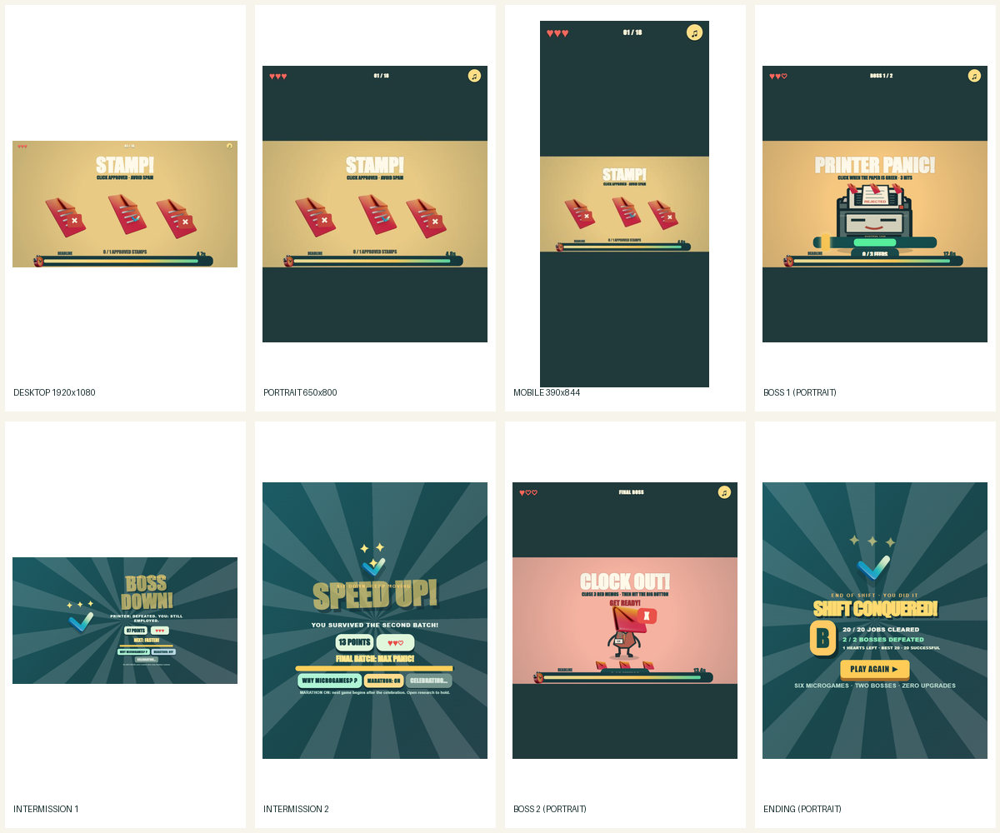

# OFFICE ATTACK | Independent creative and input QA

**Lane D** | Source: rebuild/night-shift-v3-hd at 1defba3ec8152fccc272d55c27ea18ebc071f93b | Contribution: agents/office-attack-qa-1109-j7

## Verdict: visual HOLD, mechanical PASS

The original HD cast atlas remains in use, and 16:9 gameplay is severely letterboxed on portrait/mobile. **The locked creative direction is NOT yet visually complete.** This PR contains only an isolated real-browser QA harness, evidence images, and this report. No production art, game, bosses, HTML, or CSS were changed.

## Executed test matrix

| Command / platform | Verified result |
| --- | --- |
| node --check qa/office-attack-creative.browser.cjs | PASS |
| node qa/office-attack-creative.browser.cjs | Expected exit 1: genuine design blockers; all three viewports and real mobile touch drag executed, zero JavaScript or asset-loading errors |
| 1920×1080 fullrun browser test | PASS: 20/20 real physical encounters, 2 bosses, both chapter breaks, optional research, final victory, replay, 3 hearts |
| 650×800 fullrun with boss retries, Marathon and research | PASS: 20/20 encounters after 2 genuine boss deaths/retries; research stops Marathon until manual Continue; second intermission auto-continues; genuine victory/replay, 1 heart, zero browser errors |
| 390×844 real CDP touch drag | PASS: seed 2, touch approved form, touchStart/12 touchMoves/touchEnd on fraudulent paper, score 2, lives 3 |

Commands for campaign reproduction from repo root (set environment variables in your shell):

- OFFICE_ATTACK_VIEWPORT=1920x1080 ; node qa/office-attack-fullrun.browser.cjs
- OFFICE_ATTACK_VIEWPORT=650x800 ; OFFICE_ATTACK_BOSS_RETRY=1 ; OFFICE_ATTACK_AUTO_INTERMISSION=1 ; OFFICE_ATTACK_AUTO_RESEARCH=1 ; node qa/office-attack-fullrun.browser.cjs

Semicolons above separate environment assignments; PowerShell uses $env:NAME='value'.

## Defect reproductions

**OA-CREATIVE-01: reused HD atlas (critical).** Current office-attack/art.js loads night-shift-v3/art/hd-cast-atlas.png and draws prominent sprite art from it. Reproduce by opening the integration page and comparing [desktop STAMP](../../qa/office-attack-creative-evidence/desktop-16x9-stamp.jpg) and [portrait Manager](../../qa/office-attack-creative-evidence/portrait-boss-manager.png). This violates the requested complete, original cute-office cast replacement. **Owner: Lane A.**

**OA-CREATIVE-02: huge tablet dark bands (critical).** Chrome 650×800, start STAMP. The hard-coded 960×540 stage shows ~650×366 pixels of gameplay: ~54.3% of viewport height outside the actual play area. Saved JPEG pixel scan identified 216 dark rows above and 249 below, ~58.1% including some in-scene dark pixels. See [actual portrait screenshot](../../qa/office-attack-creative-evidence/portrait-stamp.jpg). **Owner: integration lead, responsive game.js/style.css.**

**OA-CREATIVE-03: mobile gameplay nearly disappears (critical).** Chrome 390×844, start STAMP. Stage fills only ~390×219 pixels in the middle: **74.0% of viewport height unused by gameplay** according to the renderer's 16:9 scaling. JPEG scan detects 312 dark rows above and 331 below (~76.2%, including some in-scene dark pixels). The result is a visually tiny game; see [actual mobile screenshot](../../qa/office-attack-creative-evidence/mobile-stamp.jpg). **Owner: integration lead.** Fix camera/composition, not by stretching sprites out of proportion.

**OA-CREATIVE-04: timer and caption visual crowding (important).** At actual pixels, the deadline rail and interaction counters occupy the bottom sliver of the 16:9 playable strip. In phone portrait, core instructions and mini-game state become extremely small. Compare [desktop](../../qa/office-attack-creative-evidence/desktop-16x9-stamp.jpg), [portrait](../../qa/office-attack-creative-evidence/portrait-stamp.jpg), and [mobile](../../qa/office-attack-creative-evidence/mobile-stamp.jpg). **Owners: integration lead for safe-area timer/HUD, Lane A for legible art.**

These are screenshot-inspected defects. The QA does not call the UI healthy merely because a script can click through it.

## Verified functional paths

- Printer Panic: three real correctly timed hits; two deliberately early hits lose exactly one heart and restart the same boss with zero hits.
- Manager Clock Out: three real memo taps then the big button; memo timeout loses one heart and restarts the same boss.
- First chapter break: occurs after first batch and Printer; opening research freezes Marathon, and Continue is required after reading.
- Second chapter break: occurs after second batch; Marathon automatically advances after its celebration without research.
- Final victory, score, grade, two-boss tally and replay resetting state.
- Real mobile touchscreen drag: [before](../../qa/office-attack-creative-evidence/mobile-touch-shred-before.jpg), [after](../../qa/office-attack-creative-evidence/mobile-touch-shred-after.jpg).

## Actual screenshots and records

[Contact sheet](../../qa/office-attack-creative-evidence/contact-sheet.jpg) · [Desktop](../../qa/office-attack-creative-evidence/desktop-16x9-stamp.jpg) · [Tablet portrait](../../qa/office-attack-creative-evidence/portrait-stamp.jpg) · [Phone](../../qa/office-attack-creative-evidence/mobile-stamp.jpg) · [Printer](../../qa/office-attack-creative-evidence/portrait-boss-printer.png) · [Manager](../../qa/office-attack-creative-evidence/portrait-boss-manager.png) · [Break 1](../../qa/office-attack-creative-evidence/portrait-intermission-1.png) · [Break 2](../../qa/office-attack-creative-evidence/portrait-intermission-2.png) · [Ending](../../qa/office-attack-creative-evidence/portrait-victory-ending.png) · [Machine-readable measurements](../../qa/office-attack-creative-evidence/results.json)

## Harness and integration

The new qa/office-attack-creative.browser.cjs uses an isolated HTTP server, real Google Chrome via Playwright, actual JPEG screenshots decoded with Python Pillow for pixel inspection, HUD geometry checks, network/JavaScript error capture, deterministic seed choice and genuine Chrome CDP touchscreen input (not fake PointerEvents or state mutation).

The script intentionally exits 1 while the visual defects remain. This indicates the **release quality gate is failing**, not that the test infrastructure is broken. It writes screenshots and JSON to qa/office-attack-creative-evidence, overrideable with OFFICE_ATTACK_CREATIVE_OUT.

Integrate and retest Lane A artwork, Lane B microgames, Lane C bosses, and lead-owned responsive HUD/game fixes. Rerun this harness plus the full 20-encounter campaign at all target viewports. **Do not treat these baseline-branch screenshots as proof that later unmerged creative changes pass.** No existing released HD/v3 or GitHub Pages deployment was touched.
