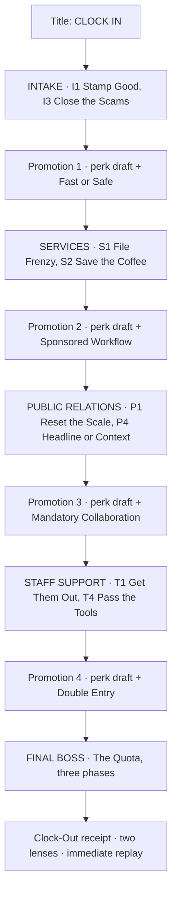

> **CODEX PRECEDENCE NOTICE (8 Nov 2026):** This is the authoritative **scope** document for playable encounters, perks, pacing and scoring. Where its earlier "research" text conflicts with `design/CCDP_P2_GAME_RESEARCH.md` or `design/COURSE_ALIGNMENT_PREFLIGHT.md`, those newer files govern academic framing. Three direct game-design inspirations: Dumb Ways to Die (microgames), Brotato (roguelite), Job Simulator (tactile job-as-toy). Papers, Please supplies narrative philosophy only. Preserve the corporate Promotion Trap, Finch/Mira/Jules, mouse precision under live distractions and the physical boss. This remains a specification, NOT an already built game.

# QUOTA PANIC: FIRST SHIFT
## CCDP10003 polished vertical-slice GDD · 8 November 2026 · v1.0

**Relationship:** A complete, standalone ~5-minute first workday from the larger *QUOTA PANIC: NIGHT SHIFT* microgame roguelite (Crystallized GDD v3). This document is the **authoritative CCDP Project 2 release scope**, not a reduction of the long-term v3 design. Build status: specification only, **not an implemented or played edition**.

> **Pitch:** Survive eight ridiculous office disasters. Every promotion grants a real ability and changes the rules. The work you've filed assembles a giant performance monster, and you defeat it while deciding whether more corporate points are worth a harder fight.

## 1. Defining promise and success conditions

This is a **vertical slice**, not a trailer, a partial level, a simulated presentation, an unfinished prototype or an abridged tutorial. It must have a beginning, escalating middle, ability build, one full climactic boss, two meaningful end-score lenses, an earned ending and immediate replay. No prompt requiring the university marker to imagine missing gameplay. Target first successful clear: **4.5–6.5 minutes**, to be measured; short replays ~3.5–5 minutes. A first player action within **15 seconds** of pressing CLOCK IN, no research text required to play, and visible cause/effect within the first three minutes.

**Core loop:** clear two physical microgames → pick one of three visible upgrades → management visibly changes a rule → apply a stronger build to two new microgames → repeat → fight THE QUOTA using the same interaction grammar → clock out, compare two honest metrics → replay.

**Quality invariant:** A short, polished game beats a sprawling, uneven one. Cut breadth before cutting animation timing, legibility, real upgrade effects, factual provenance, music/SFX, boss clarity or a complete ending.

### 1.1 Decisions not subject to reopening

- Single-screen **fullscreen 2D cartoon browser arcade**, pointer-first with touch fallback; original paper-theatre art language and expressive cast. No 3D office or required software application navigation.
- Microgame **roguelite**, not single-arena sorting and not unrelated WarioWare cards. Every card uses tap, drag, hold or flick; props, input rules, perks and consequences recur.
- **Eight authored cards, all present on the first run** in a deliberate order. Replay variations are seeded layouts, optional route and hazard variations, build and player choices, not removal of essential argument beats.
- **Four upgrade drafts, four stage-bounded directives, one three-phase final boss**, three bolts and four scored filing-or-cooling packets.
- Complete self-contained ending and functioning replay. The full Night Shift 12-of-16 roster and Printer Mutiny boss remain **expansion**, not invisible prerequisites.
- No hard-coded good-versus-evil choice. Corporate score is arithmetically honest and worker access is physically visible.

## 2. Player journey and locked topology

| Approx. arrival | Action / emotion | Guaranteed playable result |
|---|---|---|
| 0:00 | **CLOCK IN** and I1 **STAMP GOOD!** | First stamp squeaks, squashes and scores; simple good-versus-spam distinction, visible streak |
| 0:25 | I3 **CLOSE THE SCAMS!** | Close counterfeit pop-ups, preserve real Mira notification; legible helpful/scam distinction |
| 0:45 | **PROMOTION 1** | Select Carbon Copy / Bank Shot / Mira Backup; see what the chosen tool physically does. Directive: **FAST OR SAFE** |
| 1:00 | S1 **FILE FRENZY!** | Throw folders into a moving marked bin, with optional bank-shot route; familiar packets become future ammunition |
| 1:20 | S2 **SAVE THE COFFEE!** | Catch two of three mugs to clear, three for mastery; Mira reacts and her workstation either remains intact or gets interrupted |
| 1:40 | **PROMOTION 2** | Select another tool, with at least one available synergy; **SPONSORED WORKFLOW** |
| 1:55 | P1 **RESET THE SCALE!** | Drag chopped-axis graph to zero; accurate 1,240 to 1,280 events become honestly shown as ~3.2% growth; separate fake and real help |
| 2:15 | P4 **HEADLINE OR CONTEXT?** | Physically route an honest report to speed (next task) or context (boss warning) without falsifying data |
| 2:35 | **PROMOTION 3** | Third build choice and **MANDATORY COLLABORATION** |
| 2:50 | T1 **GET THEM OUT!** | Guide 2 of 3 coworkers to exit; optional third rescue is logged, not assumed |
| 3:10 | T4 **PASS THE TOOLS!** | Route two $40 licences to Mira/Jules or save the funds; all 3 allocations of 0,1,2 licences legal and immediately reflected |
| 3:30 | **PROMOTION 4** | Final upgrade and **DOUBLE ENTRY** for the boss |
| 3:45 | **THE QUOTA** | Real three-phase boss with stamp lanes, advertisements, feeder/gear countershots, four FILE (+5) or COOL (safety) packets |
| 5:00 | **CLOCK OUT** | Machine dismantles itself, physical stamp impact, short funny receipt with Corporate vs People/Quality lenses, replay control |

*These are authored pacing targets, not measurements. No mandatory exposition gates. Stage and boss timers pause with the game. Failure must not force replaying a tutorial.*

## 3. Eight cards: complete mechanical contracts

Each card requires (a) a large verb, (b) one visual tutorial gesture on first exposure, (c) physically satisfying feedback, (d) clear success/failure, (e) interaction with at least two perks or one perk and the directive, (f) one visible consequence or visual joke.

| ID | Primary input and objective | Mandatory consequence / reuse | Distinct failure feedback |
|---|---|---|---|
| **I1** | Tap/stamp 5 approved documents, leave spam. | Combo makes stamps feel better; paperwork is later a boss projectile; legitimate Mira notice appears after initial learning | Ink splash on wrong item, faux marketing subscription |
| **I3** | Close 3 counterfeit popups, keep/use real signed notice. | Identifying help is later relevant in the Sponsored Workflow boss interruption | Fake celebrates being clicked; real help closes with missed-assistance receipt |
| **S1** | Drag/release 3 folders into marked moving chutes; optional bumper bank shot. | Bank Shot, Carbon Copy, Magnet Grip, Chain Stamp apply physically; packet silhouette reappears in boss | Ricochet into a harmless but absurd shredder gag |
| **S2** | Drag tray under ≥2 of 3 mugs, three for mastery. | Successful protection allows Mira's early warning; spill is seen and recorded, not fictional injury | Comic splash and interruption on screen |
| **P1** | Drag chart baseline to actual zero, reveal 1,240→1,280 = +40 ≈3.2%, then stamp send. | Real action demonstrates selective framing; Sponsored Workflow includes distinguishable help/scam and objects used as cover | Misplaced axis bounces back, oversized graph visually collapses into true proportions |
| **P4** | Drag verified report to HEADLINE or CONTEXT. | HEADLINE grants one Staff Priority Pass; CONTEXT grants one boss Warning Card; report cannot claim unseen overtime | Bad release returns sheet; player can inspect before committing |
| **T1** | Sweep safe route for ≥2/3 visible coworkers, third as skill bonus. | Count 0–3 saved workers explicitly; optional third rescue contributes visible later worker assistance | Worker visibly stops and signals, not a silent statistic |
| **T4** | Drag two $40 licence tokens to Mira, Jules or SAVE $40. | $80 total conserved; keep access yields specific boss tech assists, savings earns company points. No synthetic copy may duplicate money | Unplaced token loops visibly back; cannot commit a fictional allocation |

**No extra compulsory microgames** may be added to this release until all eight, the full boss and the ending pass functional and visual assessment. Occasional micro-animations, tutorial gestures and title interactions are not counted as separate cards.

## 4. Real roguelite depth within a short slice

### 4.1 Six production perks, three build engines

| First draft identity | Supporting perk | Genuine cross-card synergy | Boss identity |
|---|---|---|---|
| **Throughput:** Carbon Copy | Chain Stamp | One ghost packet can serve a *different unresolved* filing target and connect a deliberate two-hit route; never duplicate licence currency or +5 boss filing | More usable ordinary ammunition and multi-target mechanics |
| **Precision:** Bank Shot | Magnet Grip | Planned bumper route around a blocked chute, preview and last-moment catch correction | Alternate ricochet countershot when direct route closes |
| **Care/control:** Mira Backup | Safety Net | Visible shield catches a hazard; Mira returns an actual usable object, not an invisible stat boost | Recovery into a real safe counter opportunity |

Six production perks are **Carbon Copy, Chain Stamp, Bank Shot, Magnet Grip, Mira Backup, Safety Net**. Do not build Time Bank or Focus Lens solely for the demo. Every perk has one visible activation within the next two encounters when offered. Duplicate copies cannot recursively copy, farm points, create a third licence or file extra +5 packets. All boss bolts require a player action, with or without perks.

### 4.2 Four promotion choices

- **Draft 1**, after Intake: fixed, readable offers **Carbon Copy / Bank Shot / Mira Backup**; Services guarantees an immediate activation for all three paths.
- **Draft 2**, after Services: fixed offers **Chain Stamp / Magnet Grip / Safety Net**; each pairs with one first-draft path. A player can deliberately pick a non-synergy alternative; that is genuine agency.
- **Draft 3**, after Public Relations: select three eligible new/L2 perks from the same six. At least one offered card must visibly activate in T1 or T4; exclude max-level offerings. A synergy completion is always offered if the current build lacks one and the eligible cap permits it.
- **Draft 4**, after Staff: select three eligible new/L2 perks that are confirmed to act during a real QUOTA phase. Demonstrate actual countershot effect on card before the fight.

Every draft card shows a 1.5-second *before/after loop*, one direct sentence and where the perk will matter. Offers and choices are deterministic for a saved seed. One choice cannot silently grant three unrelated bonuses. Replay different builds without persistent grind.

### 4.3 Four directives, each materially changes actual play

Only **one** directive applies to the next department/boss; never invisibly stack directives or change mouse controls:

1. **FAST OR SAFE (Services):** every applicable card shows a narrow fast route and a wider safer route; time/risk consequence comes from chosen action, not a magic hidden difficulty value.
2. **SPONSORED WORKFLOW (Public Relations):** credible assistance and counterfeit overlays both appear; the player must choose which to use, dismiss or physically exploit. Genuine help can never be impossible to distinguish.
3. **MANDATORY COLLABORATION (Staff):** visible coworker participation improves one route but costs a deliberate gesture. Solo completion remains achievable and is not moralised.
4. **DOUBLE ENTRY (THE QUOTA):** one marked confirmation step per boss phase unlocks a feeder route using a visible linked copy; the original three required countershots remain unchanged.

A directive must visibly transform **both cards** of its department, or one full boss counter cycle plus a repeated later action. Implement a real before/after demonstration. If it doesn't change the player's physical strategy, cut or redesign it rather than renaming a timer modifier.

## 5. THE QUOTA: one complete, earned finale

The background machine gains a module after each promotion; the four modules connect into the boss after Staff. It has **three physical bolts**, and **three necessary countershots**. It never dies from generic spam-clicking.

- **Phase 1: APPROVED.** Giant stamp telegraphs a lane; player avoids/dismisses it, opens a marked feeder, fires a familiar work packet into gear one. First shot is forgiving, no fake difficulty.
- **Phase 2: SPONSORED.** Real help and counterfeit ad appear; player chooses an interaction, can throw an ad as cover, then catches a safe sheet and hits moving gear two.
- **Phase 3: OPTIMISE.** A visibly marked double-entry confirmation and changing office lanes require planning. Earlier saved tools, worker rescues and perks change **how** the player gets the final opening, but don't auto-clear bolt three. Gear three comes off, machine folds into the CLOCK OUT stamp.

**Four explicit boss choices**, distributed 1 / 1 / 2 across phases: the same incoming packet can be **FILED** for **+5 OFFICIAL QUOTA** and +1 pressure (max pressure 2), or **COOLED** for no QUOTA bonus and a visible +0.75 s counter opening. All FILE and all COOL remain winnable by skill with zero perks. No silent reward removal or hidden rewriting of scores.

**Consequences earned during work:** Mira's protected workstation gives one warning; P4 CONTEXT gives one longer telegraph versus HEADLINE's earlier Staff benefit; worker mastery can provide one safety sheet; saving licence tokens gives corporate score, giving them to Mira/Jules unlocks specific boss assistance. All are physical and testable, not written into a cutscene.

## 6. Scores and closure, no bookkeeping fraud

The final receipt is a visual prop rather than a mandatory exam. Both metrics derive from the same frozen, replay-safe run ledger. On-screen action shows only **hearts + time + imperative + active directive glyph**; score bursts are allowed locally at hit targets, and exact accounting can be expanded on the receipt.

**OFFICIAL QUOTA /100:**

| Component | Formula | Maximum |
|---|---|---:|
| Completed work | `40 × distinct completed authored card IDs / 8` | 40 |
| Pace | `15 × average(clamp01(1 − elapsed / referenceTime))` over committed cards; no extension to reference time | 15 |
| Clean streak | `15 × clamp01(longest committed clean manual streak / 8)` | 15 |
| Savings | `10 × savedDollars / 80` | 10 |
| Bonus filed | `5 × distinct boss bonus packets FILED`, max 4 packets | 20 |
| **TOTAL** | `round(sum)` once, clamp 0–100 | **100** |

**PEOPLE & QUALITY /100:**

| Component | Formula | Maximum |
|---|---|---:|
| Support | `35 × (workersHelped / workersEncountered)`; 1 Mira workstation incident + 3 Staff coworker opportunities | 35 |
| Software access | `30 × licenceTokensGiven / 2` | 30 |
| Careful action | `20 × correctManualActions / max(1, correctManualActions + wrongManualActions)` | 20 |
| Real notices | `15 × safelyHandledRealNotices / encounteredRealNotices` (plus separately record scams dismissed) | 15 |
| **TOTAL** | `round(sum)` once, clamp 0–100 | **100** |

Completed card IDs are exactly eight for a successful full run. Saved dollars plus `40 × licenceTokensGiven` must equal **80** after the T4 commitment. Four numbered boss packets may each be resolved exactly once; cooling cannot score +5 and synthetic copies cannot become extra packets. Failed/uncommitted tries never change the final ledger. The receipt visually flips between the two different but honest evaluations of the same shift. Optional **HOW COUNTED / SOURCES** panel exposes the formulas and three properly attributed, verified game-design/research sources, without interrupting play.

**End is an actual finale:** gear three bursts, giant CLOCK OUT stamp crushes the machine, Finch gives a corporate title, Mira turns the receipt over, player sees actual coworkers and dollar outcome, **PLAY AGAIN** starts a new seed. No essay, final quiz, courtroom, open-ended conversation or unfinished cliffhanger.

## 7. Art, sound and polish contract

Art must be integrated and intentionally framed, not bulk-generated sprite collage or empty widescreen backdrop. **Corporate Paper Theatre**: original bold 2D shapes, thick purposeful silhouettes, differentiated inks, physical paper grain, squash/stretch, original faces for Finch, Mira, Jules and QUOTA, expressive micro-reactions; consistent lighting direction and camera scale. Build sprites and effects to the actual screen space rather than filling with generic details.

- **Minimum character states:** Finch cheerful/greedy/alarmed; Mira working/relieved/frustrated/helping; Jules working/locked-out/helping; QUOTA idle/telegraphing/hit/defeated. One interconnected modular boss, not three unrelated enemy designs.
- **Mandatory microgame feel:** meaningful input latency, overshoot-and-settle on throws, crisp stamps, visible impacts, anticipatory guides, distinguishable hits/misses, fast one-second joke animations, physical upgrade demonstrations, accessible reduced-motion alternative.
- **Sound:** original or properly licensed/composed audio, at least one engaging responsive track with percussion layers for promotions/fight, clear stamp/catch/throw/error/help/upgrade/bolts/defeat effects, mute option and no autoplay block issues.
- **Visual performance:** actual content fills 16:9 desktop; targets remain readable at 1366×768 and 1024×600, plus narrow 650×800; body text is not tiny; safe areas and input alignment tested. Do not let cinematic art obscure interactable objects.
- **HUD:** two tight corners for hearts and time, one instruction, directive glyph. Rest is spectacle, not persistent text soup.
- **Fairness/accessibility:** tap-safe minimum target sizes, full pause/resume, no flashing beyond accessibility limits, clear visual tell independent of audio, reduced motion, optional Practice continuation, no misleading timer during a paused intermission.

**Quality bar:** compared side by side with live V3 and Night Shift screenshots, demonstrate stronger scene density, main-character clarity, animation purpose and input readability. A strong illustration is not proof of good game feel. An AI image never substitutes for integrated sprite animation and independent visual QA.

## 8. Research and course argument within play

**Four assessed dimensions**, each with direct evidence in the playable work:

1. **Topics/strategies:** meaningful scaffolding, reward loops, feedback, failure/retry, progression, interruptions, gamification, economy and optimisation. Work through the mechanics rather than citing names on a splash screen.
2. **Critical gaming culture:** same score mechanics can encourage risk, and helpful upgrades carry corporate pressure; popups blur real aid and manipulation; corporate and human metrics disagree honestly. Show positive reward value as well as trade-off, never simplistic anti-game propaganda.
3. **Inventiveness:** a short comedic procedural argument, physically enacted, with transformations of earlier props into the boss and character reactions driven by observed state.
4. **Clarity:** immediate tutorial, readable goals, no hidden morality, direct visible $40 allocations, demonstration of the chart's actual scale, contextual optional sources and two equally transparent final score lenses.

**Research delivery:** two tiny optional contextual `?` links in pre-existing intermissions, one relating interruptions/rewards and one relating selective chart framing; a 3-source end-screen SOURCES drawer, with direct links to genuine publications. These are *subordinate to the action*. Add a short authored "WHY I MADE THIS" note only with the student's own approved facts; do not invent autobiography. Do not claim fictional clicks, dollars or scores are research statistics. The lecturer's previously provided feedback favoured the physical, funny interruptions and criticised a late explanatory section; avoid repeating that defect.

## 9. Testing and promotion gates

A release candidate must pass **all** of these, independently of designer enthusiasm:

**Gameplay and state:** Start from empty storage; complete all eight cards and all three boss phases by real pointer interaction; all three first-perk paths and at least three genuinely different synergy builds have visible effects; directives change actual objects/choices; all three licence dispositions and all 16 file/cool patterns score correctly; every feasible wrong action has bounded feedback and recovery; cards cannot be double-credited through retries; pause freezes gameplay clocks; returning a saved game doesn't resurrect closed rewards; replay creates a fresh seed and complete new run.

**Presentation and UX:** Render-and-inspect at 1440×900, 1366×768, 1024×600 and 650×800; test real pointer-coordinate mapping, screenshots before/after interactive states, no unreadable text or cut-off buttons; title, each distinct game family, upgrade and boss phase are visually reviewed. Record first-click latency, total clear time and failure rate from automated traces; only claim human enjoyment if assessed by actual human players, not scripted clicks.

**Academic and submission:** Rubric matrix maps actual moments rather than intentions to each 25-point criterion; a marker can play without an account or creator narration; in-game research source panel renders/opens; live public URL is tested, not merely local HTML; original working route remains a rollback; main/root routes aren't altered until new slice beats incumbents; submit **public working link** and confirm Canvas receipt by **Monday 9 November 2026, 11:59 pm AEDT**. This deadline is from cached course data, not a freshly verified account submission.

**No false release status:** This doc and a valid JSON model are not evidence that the new game exists. Before actual tests pass, label it specification, not playable. Never claim a promised grade or certainty of 100/100.

## 10. Stop doing / preserve for the larger game

**CUT FROM CCDP slice:** 8 of 16 other microgame cards, all Printer Mutiny boss sequences, Time Bank / Focus Lens perk implementations, Moving Goalposts directive, a second act after THE QUOTA, complex persistent unlocks, city/world maps, 3D monitor, full-featured spreadsheet apps, supplemental research lectures, extra currencies, daily streak grind, extra menus and alternate end cinematics.

**DO NOT CUT:** real player agency, three synergy build types, consequences that alter play, 3-phase boss, genuine scored FILE-versus-COOL decisions, comedy, bespoke art/audio, accessibility/pause/replay, original research sources and public-link QA.

**Preserve existing builds** as baselines and rollback targets. Reuse proven V3 action/draft/QA systems, Night Shift character/music/illustration work and Workday's honest evidence/licence mechanics **only where direct extraction is technically safer and cleaner than rewriting**. Never transplant an entire heavyweight office desktop just to salvage one interaction.

**Design status:** Authoritative CCDP scope decision. **Production status:** not implemented/tested. Full Night Shift remains the long-term master GDD and isn't overwritten.