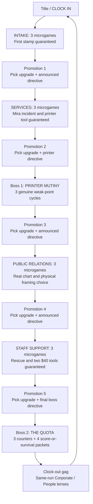

> **CODEX PRECEDENCE NOTICE (8 Nov 2026):** This is the **long-term full-game design reference**, **not** the implementation scope for Project 2. The First Shift vertical-slice GDD, current `CODEX_HANDOFF.md`, `design/CCDP_P2_GAME_RESEARCH.md` and `design/COURSE_ALIGNMENT_PREFLIGHT.md` control the CCDP candidate when they conflict. Do not build the full 16-card campaign, second boss, or extra perks for the submission. Earlier gamification-first research is superseded by the three gameplay pillars plus Papers, Please as philosophical lore. Use v3 to preserve the complete Promotion Trap story, original characters and design invariant. This document is research/reference, not evidence of executed gameplay.

# QUOTA PANIC: NIGHT SHIFT
## CRYSTALLIZED GAME DESIGN DOCUMENT · v3.0
**8 November 2026 · Authoritative next-build specification · 2D browser microgame roguelite**

> **The corporation gives you a real upgrade, then changes the rules. You become better at surviving a workplace that becomes worse at being a workplace.**

**Status distinction:** This is the strongest *design target* produced from the previous concepts and actual branches, not a representation that the v3 integrated game has been developed, played or graded. Existing V3/Night Shift remains the implementation benchmark; Workday PR #8 remains the critique benchmark. A design cannot truthfully win the **implemented** and **visual execution** categories until it has beaten those builds in browser play and visual review. This document explicitly specifies how that promotion is earned.

**Genre:** single-player comedy **microgame roguelite**, not an office app simulator, single-room sorting game, unrelated game anthology, platformer or courtroom game. **Platform:** fullscreen responsive HTML5, pointer-first desktop, touch-friendly, immediate public-URL launch. **Audience:** someone with zero course knowledge who wants a ridiculous 7–10-minute game. **Run:** twelve short microgames chosen from sixteen authored cards; five one-click upgrade choices; five visible corporate directives; two mechanic-driven boss encounters. **Replay:** seeded challenge variation and build/directive combinations, not a required grind. **Action HUD:** hearts, countdown, two-to-four-word imperative; everything else moves to the breathers.

### The entire game in three sentences

Clock in to a ridiculous corporation and survive twelve tiny office disasters by stamping, flinging, catching, dragging and rescuing your way through an increasingly chaotic shift. After each promotion you choose a genuinely powerful upgrade, but the company announces a new rule that forces you to rethink how you use it. Your own successful work has been constructing the gigantic **QUOTA** machine, and in the final boss fight you decide moment by moment whether to file more work for corporate points or redirect it to survive.

### The non-negotiable quality hierarchy

1. **Playability and joy without explanation:** what you do must be funny, tactile, clear and worth replaying. Strip out all research text and test this first.
2. **One evolving game rather than twelve disconnected minigames:** shared tool language, persistent build, visible consequences, reappearing props/characters, rules that apply across encounters, boss payoff.
3. **Real decision depth in a small space:** multiple viable build routes, disclosed rewards and compromises, input skill and situational adaptation. No pseudo-options or hidden morality meter.
4. **A distinctive, finished visual/audio identity:** dense, legible action staging and purposeful animation, not underused backgrounds, generic UI, or unrelated sprite sheets.
5. **Course argument encoded in the mechanics:** gameful rewards are genuinely helpful, incentives redirect decisions, and a truthful metric can omit important facts. Optional sources substantiate rather than replace the experience.
6. **Technical reliability and shipping quality:** complete run, replay, pause, touch, accessibility options, deterministic tests, real browser inspection and rollback.

The project cannot claim victory on one axis by quietly sacrificing another. In particular: no academic lesson in place of a game, no special-effects substitute for mechanics, no novel idea that damages clarity, no theoretical polish promoted over a working version.

---

# 1. What makes v3 worth making

## 1.1 The single original-feeling connective idea: **THE PROMOTION TRAP**

Every department follows the same understandable cause-and-effect: **do work → receive real, enjoyable power → management raises or changes a disclosed demand → adapt your strategy → produce yet more output**. The promotions visibly add components to a mysterious machine behind the office. This is not a hidden punishment for scoring well: each escalation is announced, demonstrated and testable, and a zero-upgrade run remains possible. The machine eventually becomes the final boss. **The monster is physically made of your promotions.**

A short microgame is not merely a self-contained gag. It introduces an object, skill, coworker or failure mode that returns later in another context. A printer jam from Services returns as a boss opening; the scam-versus-help distinction returns as a final boss hazard; a tool handed to Mira affects an actual final-fight assist; filing for a visible bonus makes QUOTA more dangerous. The player learns through familiar things transforming, not through instructions explaining a theme.

### Why this synthesis exceeds the old proposals as a design

- **Versus 3D ASTER OS:** keeps an immersive *office personality* without walking, monitor switching or navigation overhead.
- **Versus Shift File/Workday:** retains honest consequence accounting, a recognisable chart distortion and concrete employee access, but embodies choices as gestures rather than menus, paragraphs and software training.
- **Versus Paper Shift/V3:** preserves bite-size comprehension, varied input, retry structure and real boss action while making shared upgrade rules and consequences join otherwise separate challenges.
- **Versus Night Shift HD/AI:** keeps its cast and email/upgrades framing, but requires bigger active characters, a filled playfield, coherent sprite scale and cinematic motion instead of a gorgeous but empty stage.
- **Versus Meltdown/Kinetic Desk:** keeps tactile throws and objects becoming weapons without making the whole game a repetitive sorting arena.
- **Versus Rulebreak Rally:** promotes announced corporate rules from flavour/difficulty knobs to *alternative tactics* across multiple microgames and bosses.
- **Versus Rhythm/Physics/Logistics:** borrows musical feedback, ricochets and situational cooperation without their full production or comprehension burden.
- **Versus the old v2 GDD:** closes scoring, builds, directive decisions, evidence order, failure idempotency, human consequences and release qualification defects.

**Novelty boundary:** Microgames, roguelite synergies, boss rule changes and office slapstick have existing analogues. Do not market this as the invention of a genre. The distinctive proposed *combination* is a corporate promotion that rewards the player and audibly rewrites the conditions of future play, with a final boss that literally feeds on the same outputs being scored.

## 1.2 The first minute, imagined as playable actions

- **00:00–00:04:** The logo becomes a CLOCK IN stamp. One enormous button. Finch: “You have been hired retroactively.”
- **00:04–00:14:** **STAMP GOOD!** A large smiling form rolls onto the desk. Its silhouette pulses. Tap it: violent rubber-stamp squash, ink burst, crisp satisfying sound, a little crown of confetti. A clearly crossed-out spam form slides past; tapping it produces an immediate silly consequence. No reading.
- **00:14–00:30:** A second form and a comic opportunity to chain two perfect hits; the music picks up a layer. Success is felt before points are explained.
- **00:30–00:45:** A real message from Mira helps you. A counterfeit promotion popup imitates it badly. One correct action reveals the difference. Later interruptions build on this rule.
- **00:45–01:05:** A brief distinct microgame (shredding or tracing), then the first promotion email. Three large upgrades: a duplicator, a bank-shot tool and Mira's help. Each card animates *exactly what it changes*.
- **01:05:** Finch applauds, attaches another mechanical module in the background, announces a clear new directive and shows its before/after in 1–2 seconds. The next task begins immediately.

**Why the loop should be fun:** immediate hit satisfaction, understandable mistakes, evolving motor skill, new verbs, anticipation of an upgrade, tactical surprise and a joke. The player is not being rewarded for reading an explanation of rewards.

---

# 2. The game topology and pacing



## 2.1 The pacing envelope

| Beat | Target active/breather time | Emotional function | Quality constraint |
|---|---:|---|---|
| Clock in / learn first stamp | 15–20 s first exposure | Instant delight | One action within 15 s of pressing Clock In |
| Four departments × 3 cards | 12 × ~10–14 s active + ~2 s card intro | Variety and mastery | No waiting for a slow cinematic after every card |
| Five promotion breaks | 5 × ~10–16 s | Relief, greed, build decisions | One click to choose; 2 sentences max of mandatory copy |
| Printer Mutiny | 55–75 s | First sustained skill test | Telegraph, jam, feeder counter; no click spam |
| THE QUOTA | 75–110 s | Climactic variation and choice | Three different phases, four actual score/survival choices |
| Ending + replay invite | 20–35 s | Funny reflection and closure | No essay, quiz or lawyer scene |
| **First successful run** | **7–10 min target** | One memorable shift | Aspirational until browser measured |

The stage clock is measured only while gameplay is active. No timer runs during previsualisation, intermissions, tab blur, pause, accessibility pause or result animation. First encounter includes a **frozen animated demonstration** lasting no more than 2 seconds, or until the player's first deliberate pointer action. Practiced run targets approximately 5–8 minutes without artificial delays. Attract/ending timings are not a substitute for real interactions.

## 2.2 Curated onboarding, real replay variation

There are **16 authored cards**, exactly 4 per department. A normal run sees 3 per department, exactly 12. Selection is seeded, constrained and auditable, not unconstrained random shuffling.

- **Intake:** `I1` always first; choose two distinct from `I2`,`I3`,`I4`.
- **Services:** `S1` (physical filing) and `S2` (Mira incident) must both appear among the **first two** Services cards, in either order; then choose exactly one of `S3` or `S4` (printer skill) as the third. This means the first promotion’s Carbon Copy, Bank Shot, or Mira Backup options each have a real use within the next two encounters.
- **Public Relations:** `P1` (real chart) and `P4` (physical framing choice) must appear; choose `P2` or `P3`. `P4` comes after `P1` and only uses recorded prior events.
- **Staff Support:** `T1` (worker rescue) and `T4` (licence tokens) always appear; choose `T2` or `T3`. `T4` comes after `T1`.
- **First run:** carefully fixed sequence `I1,I2,I3 | S1,S2,S3 | P1,P2,P4 | T1,T4,T3`. Fix first upgrade options and the first directive tutorial; later variety is seeded.
- **Subsequent runs:** valid roster permutations, directive assignments and upgrade drafts vary without violating teaching order. At least 24 distinct roster combinations before ordering, directives or builds. No card duplicated within a run.

The mandatory encounters are not padding. They establish the causal thesis for someone who plays exactly one run: rewarding work, coworker consequence, gameable chart, meaningful resource transfer and a finale where scored work amplifies pressure.

## 2.3 Recovery versus roguelite identity

**Standard Shift:** begin with **3 hearts**. A clearly caused error or incomplete timer can remove one, never twice for one failure. Hearts persist within a department; after a promotion, restore **one** up to 3. An incomplete card restarts immediately from the same seeded layout, without counting an aborted attempt as completed. On reaching zero hearts, one visible **UNION BREAK** continue is available for the whole run: resume the current card or boss phase with 3 hearts, preserving legitimate previous completed work. A second zero-heart wipe ends the run and offers **New Shift** with a new seed, plus a clear optional practice continuation. This is a true replayable roguelite, not an endlessly auto-cleared story.

**Practice Shift:** the same game and consequences with unlimited scene checkpoints and adjustable timing, clearly labelled on the result. This ensures accessibility and avoids losing the marker to early failure, without secretly rewriting Standard rules. The end-of-run corporate and people scores are still calculated honestly from committed actions, but the report visibly identifies Practice/continued status. Nothing shameful or moralising about using assistance.

**One bad click must never reset six minutes of work.** Boss checkpoints persist on a continue; ordinary cards only restart their own active attempt. A deliberately chosen New Shift resets run-specific perks and directives. Permanent rewards, if any, are cosmetic/stickers/scene memories, never mandatory power unlocks. No account, meta-currency grind or login.

---

# 3. Player grammar, feel and fairness

## 3.1 One tool language, different cognitive problems

| Verb | Physical response | Ordinary uses | Boss reuse |
|---|---|---|---|
| **STAMP / TAP** | 70–120 ms compression, ink splat, sharp confirmation and recoil | approve, timing, dismiss scam | parry sheet, press exposed mechanism |
| **GRAB / DRAG** | weighted movement, pickup shadow, active target halo | folders, chart axis, cable, tool transfer | pull jam, carry packet |
| **SWEEP / GUIDE** | short visible trail, objects follow a wide collision target | mug tray, staff route, moving safety barriers | sweep hazardous pages away from a zone |
| **HOLD** | visible filling ring and changing tension sound | stabilise projector, activate repair | hold shield or feed weak point after telegraph |
| **FLICK / RELEASE** | short predictable arc, readable bounce and satisfying landing | shred junk, launch tool, ricochet a file | strike open feeder / QUOTA gears |
| **TIME / WAIT** | warning stripe and audio cue, permissive safe window | clock-out, automatic gate | counterattack after a stamp slam |

Input controls remain stable across all directives. No rule silently changes whether click means click or drag means drag. A target flashes and physically responds at first touch. Drag intent engages only after a ~6 CSS-pixel movement threshold (scaled appropriately for touch). Release targets have clear magnetic capture/target markers; manual precision is still rewarded. Everything important can be accomplished by **one pointer** without a keyboard. `Esc` pause, `M` mute, `F` optional fullscreen, and accessible menu focus are supplemental.

### Mandatory animation/audio principles

- **Anticipation → impact → recovery:** every important event has three readable poses, not a generic scale tween. No input lock during the action window.
- **One cause, one expressive reaction:** a wrong stamp makes the specific mistaken document retaliate; a missed coffee makes Mira's workstation sputter; a boss hit physically removes one of three bolts.
- **Sound communicates affordances:** dull tap for grab, punchy pop for approved stamp, melodic streak accent, paper whistle for thrown objects, descending cue for a hazard. Audio can be muted without losing any warning.
- **Rhythm, not a rhythm game:** successful actions add layers to an original percussive office score; interruptions cut a beat; boss phases rearrange the same motif. Never force a music-timing calibration.
- **Game-feel is measurable in captures:** stamp impact <140 ms after the action; collision feedback immediate; a victorious microgame does not hold more than 0.8 s before the next task; telegraphs precede harm. Numbers are design budgets to tune, not measured characteristics of the existing build.

## 3.2 A fairness contract

1. The game never deals hidden damage while the screen is obstructed or paused.
2. A new directive is announced before the next action, demonstrated with a pictogram, and remains visible as a small glyph when active.
3. Nothing teleports from under a drag. Destination changes occur at a staged lull, with a visible movement path.
4. All challenges work with no perks. Perks help, change routes, or produce new opportunities; none is a required key.
5. Dangerous targets use shape, icon, motion and silhouette, never colour alone. Genuine notifications use sender portrait and seal; scams have a recognisable forged tell, not a coin-flip trick.
6. Every microgame failure says what failed in one animation, not a paragraph. Timed-out target does not retrospectively become a mistake of another type.
7. A result is never presented as verified if it came from unobserved or skipped gameplay. Optional evidence sources cannot repair missing facts automatically.

---

# 4. The sixteen authored microgames

Each row is a **real mechanically distinctive card**, playable in ~10–14 seconds after first exposure. `Success` is the explicit objective for a standard clear; **secondary results** can differ even if the player succeeds. This is how we preserve Workday's cause-and-effect without turning the game into paperwork. Each card must have a real wrong-input path, one clear animation gag, a directive hook and at least two relevant perk hooks.

## Department I: INTAKE · Why scores feel good

| ID | Screen prompt | Physical challenge / success | Variable consequence and payoff |
|---|---|---|---|
| **I1** | **STAMP GOOD!** | Tap 5 large approved forms, ignore crossed-out spam as conveyor speed gradually increases. Tap, reaction, streak and audible perfect hit. Always first. | Spam tap costs a heart and subscribes the desk to ridiculous marketing; after clear a real Mira note and one fake promo visibly teach notices. The tutorial helps before it tricks. |
| **I2** | **SHRED THE SPAM!** | Sweep 2 junk envelopes into a cartoon shredder while protecting one clearly marked real pay slip. The shredder sucks in with physically legible force. | Shredding the pay slip records one error; saved pay slip reappears as Mira's paycheck joke later. |
| **I3** | **CLOSE THE SCAMS!** | Close 3 fraudulent overlay windows while preserving a real notice with portrait/seal. Pointer paths are unobstructed and windows physically flap offscreen. | Real help can be opened for a visible assist; closing it loses that optional assist and logs a mishandled genuine notice. |
| **I4** | **COPY THAT!** | Follow a visibly lit two-corner carbon-copy route to stamp 3 linked forms in one gesture. The route is easy to read, demanding enough to perform cleanly. | Bad trace creates duplicate clones and a comic pileup. The copy object foreshadows Carbon Copy perk and boss photocopies. |

**In every run:** a visible legitimate notification and scam temptation occur after the first successful stamps, guaranteeing an observable care/attention metric without distracting the first click. The first promotion occurs after three distinct tasks, not after an academic introduction.

## Department II: SERVICES · Success creates problems

| ID | Screen prompt | Physical challenge / success | Variable consequence and payoff |
|---|---|---|---|
| **S1** | **FILE FRENZY!** | Pull 3 chunky folders into the currently highlighted destination; optional bank shot off a big obvious bumper. Unlike Meltdown, targeting involves timing and occasional moving geometry, not sorting labels. | Correct clean files become familiar throwable packets used later against the printer and QUOTA. |
| **S2** | **SAVE THE COFFEE!** | Sweep a broad tray under at least 2 of 3 wobbling mugs before they hit Mira's workstation. Each catch is a chunky physical rescue; third catch is optional mastery. Always encountered. | If all 3 are caught Mira's workstation remains fully functional and she later supplies a helpful timing alert. A spill is visibly recorded as disruption, not invented injury or an unseen statistic. |
| **S3** | **UNJAM IT!** | Wait for the printer's lit safe moment, grab a page protruding from its mouth and pull to an illustrated release mark. | Early tug makes the printer cough a paper cloud, creating a visible learnable mistake. This exact gesture opens mid-boss vulnerability. |
| **S4** | **FIX THE CABLE!** | Hold a shaking socket steady, then trace the single glowing wire to the right port before the restart pulse. | The machine reacts with a dramatic reboot or an electrical sneeze; this teaches the alternate jam-opening route. |

S1 and S2 are both guaranteed **immediately after the first promotion**, and one of S3/S4 comes directly before the printer boss. The S2 incident is guaranteed *before* the PR department, so later staff information can honestly reflect something the player actually saw. A failed attempt is rewound visibly and never counted as completed work.

## BOSS ONE: PRINTER MUTINY · Skill check, not a health bar

The printer has a face, three visible attachment bolts and a dangerously overconfident feeder. It does not take damage from arbitrary clicks. Three complete mechanical cycles remove the bolts and win:

1. **Telegraph:** printer rattles, arrows and an audio cue reveal a wave of sheets. Pointer can grab or stamp the safe counter sheet; no invisible player-body damage.
2. **Create opening:** the printer jams, leaving one marked page or cable exposed. Use the already learned safe pull/hold to open its feeder. If player did not see S4, the boss's default path remains the guaranteed S3-style page pull.
3. **Counter:** flick a recovered packet into the visibly open feeder (larger target on first cycle). On hit, a bolt springs off, the printer staggers and the next pattern begins. A miss resets that *counter opportunity*, not the entire fight.

**Each cycle changes one thing**: first static feeder, second feeder shifting on a telegraphed rail, third feeder plus a familiar corporate popup. The announced boss directive modifies exactly one readable pattern. Each bolt removal is an actual state transition, never arbitrary HP depletion. Mira and perks affect the position, number, timing or safety of counter opportunities, not pretend damage numbers.

## Department III: PUBLIC RELATIONS · Numbers can be accurate but incomplete

| ID | Screen prompt | Physical challenge / success | Variable consequence and payoff |
|---|---|---|---|
| **P1** | **RESET THE SCALE!** | Two correctly labelled click totals, **1,240 → 1,280**, look enormous on a chopped vertical axis. Drag the massive red chart baseline down until **0** snaps into view, revealing **40 more / ~3.2%**. Stamp SEND before the shutter. Mandatory. | Correction is visibly mathematical, not a quiz. The player must manipulate the misleading presentation instead of reading a lecture. Accurate values do not change when the chart scale changes. |
| **P2** | **POP-UP PURGE!** | Flick 2 hostile sales overlays off a shaking projector while leaving one clearly marked genuine alert available. Unlike I3, the popups can be used as physically throwable cover. | Incorrect dismissal may hide help but cannot erase historical facts; a properly opened alert prepares the next task. |
| **P3** | **HOLD THE SLIDE!** | Hold the projector dial within a broad moving focus zone until its three illustrated alignment marks lock. | Bad focus projects Finch's enormous face sideways onto the wall; clean focus produces a satisfying click sequence. |
| **P4** | **HEADLINE OR CONTEXT?** | A card with real, already-recorded events slides toward two clearly marked outgoing routes. Flick/drag it to **HEADLINE: faster next task** or **CONTEXT: earlier final-boss telegraph**. Both are valid, visibly useful tactics; never a hidden 'good person' answer. Mandatory, after P1. | The slide's actual facts remain true. Headline emphasises throughput and grants a one-time **Priority Pass** for the next Staff card; Context reveals the observed Mira work interruption and grants a **Warning Card** that lengthens one QUOTA tell. If no incident occurred, the card explicitly says **NOT OBSERVED**, rather than fabricating it. |

P1's baseline is a real visualisation issue, P4 is an actual tactical choice and both relate to what performance measurement privileges. The game's score lenses later use the same archived events. Neither is a legal argument or a pop quiz.

## Department IV: STAFF SUPPORT · What the score overlooks

| ID | Screen prompt | Physical challenge / success | Variable consequence and payoff |
|---|---|---|---|
| **T1** | **GET THEM OUT!** | Sweep a safe path through a busy corridor and guide at least 2 of 3 visible coworkers into the big EXIT, with the third rescue as optional mastery. Mandatory. | Each coworker reaches the exit physically or is visibly left behind. The actual 0–3 count, not a scripted moral, enters the People metric. |
| **T2** | **CLEAR THE EXIT!** | Flick toppled office boxes to open a route, exploiting readable bumps and chain-reaction physics. | A perfect chain opens space for a worker; a bad fling topples Finch's officious safety poster. |
| **T3** | **CLOCK OUT!** | Tap the giant clock only inside a generously marked green release window, while overtime hands sweep past in simple readable patterns. | An early slam earns a literal `OVERTIME` stamp and a recorded extra shift tick; the company still congratulates productivity. |
| **T4** | **PASS THE TOOLS!** | Two large licence tokens, **$40 each**, ride a conveyor. For each, physically pass it to **MIRA/JULES** (they keep software access) or divert it to **SAVE $40** (the company keeps the cash). Mandatory, after T1. | Exact, conserved consequences: **licences given 0/1/2; savings $80/$40/$0**. Workers immediately use or lose their visible tool. Given licences unlock one tangible tech assist in THE QUOTA; saved dollars boost the Corporate lens. No imaginary budget offset or claim that saving helped staff. |

T4 is *not* 'do the moral thing or lose'. Saving money is a real, immediate scoring advantage. Keeping access creates real boss assistance and raises the People lens. A split allocation is legal. Missed/unassigned tokens are **pending**, not fictitiously given or saved; the player can retry the active card before a result is committed. Anyone who completes the card has allocated both tokens. This honours the stronger Workday branch's causal detail without importing office application menus.

### Microgame design invariants

- Each microgame has a **one-line imperative**, two-or-fewer main control gestures, first-exposure demonstrated action, explicit win test and explicit loss test.
- Each microgame has at least one cause-and-effect gag. No generic red flash or abstract 'wrong' banner as sole feedback.
- The same object appears in at least **two contexts** across the run; e.g. paperwork is scoring object, projectile and boss fuel; popups are distraction, physical barrier and boss cover; staff tools are gifts, budget choices and active boss assists.
- No two adjacent microgames are purely identical drag-into-matching-tray tasks. Tactile variety is a mechanic, not a new background colour.
- A microgame must be solvable with standard input and no perks. The required step count does not exceed an approachable 10–14 s practiced window, with first-exposure leniency.

---
# 5. The roguelite economy: builds that actually play differently

A roguelite needs combinable *rules*, not five randomly selected small conveniences. There is **one reward choice after each promotion**, five picks per run, eight authored perk types, at most Level 2 of any one perk, and **three** visible offers each time. The player is never asked to perform actual spreadsheet calculations or grind currency. Each upgrade is a physical cartoon object pictured and demonstrated inside a one-click **Survival_Kit.xlsx** parody. Selecting it immediately changes encounters, without hidden score magic.

## 5.1 Eight deliberately different perks

| ID / object | Level 1: player-visible operation | Level 2 | Must work across these contexts |
|---|---|---|---|
| **CARBON COPY** (`perk:carbon-copy`) / duplicator | The first clean manual interaction with an eligible paperwork object creates **one visible ghost copy** of the next eligible object, once per microgame. (No copy if no second eligible object exists.) Ghost can be thrown, stamped or spent as a spare valid object. | Up to two copies per microgame, generated on the first and third eligible manual successes when source objects remain. Still limited by valid authored objects. | I1/I4, S1, P2/P4, T2/T4, boss spare packets. |
| **CHAIN STAMP** (`perk:chain-stamp`) / rubber-stamp assembly | After two clean target hits, the **next eligible stamp or object landing** makes one nearby legitimate target react too, illustrated with a giant ink-chain line. Once per card. | Trigger after one clean hit, up to twice per card. | I1/I4, S1, P1/P3, T2, sheet/gear targeting in bosses. |
| **BANK SHOT** (`perk:bank-shot`) / desk bumper | Flingable objects can make one controlled bounce off a glowing bumper without losing target validity; an arc preview briefly shows the bounce. | Two controlled bounces, with a visible trajectory. | I2, S1, P2, T2/T4, both bosses. |
| **MAGNET GRIP** (`perk:magnet-grip`) / glove | Catch/drag interaction radius +20%; the last 0.2 s of a release receives a slight *visible* correction toward a valid marked target. | Radius +35%, a modest stronger marked-target correction. | I2/I4, S1/S2, P1/P3, T1/T4, both bosses. |
| **MIRA BACKUP** (`perk:mira-backup`) / walkie-talkie | Once per department, an animated Mira action can catch one recoverable mistake **or** supply one safe packet; the player sees the action, not an invisible shield. | Two interventions per department (max one per boss phase). | S2, P2/P4, T1/T4, printer and final boss. No fabricated staff rescue. |
| **SAFETY NET** (`perk:safety-net`) / desk umbrella | Once per department, a visible deployable cushion absorbs a hazard, then folds shut. Each boss phase has one use. | Two blocks per department; at most two per boss phase. | All card families and bosses where a concrete hazard exists. |
| **TIME BANK** (`perk:time-bank`) / overtime clock | Each clean completed card banks up to **2 seconds of genuinely unused** authored active time, to a total reserve of 6 s. When a later card falls below 3 s, **the player taps the clock icon to spend** up to 2 s. | 10 s reserve, up to 3 s spent per card; never changes the underlying authored reference time used for corporate pace scoring. | All card families and both boss timers. |
| **FOCUS LENS** (`perk:focus-lens`) / inspector loupe | One optional scan per card briefly reveals a fake popup, a moving hazard's next path or the truly live target before the player acts. A 1-second freeze affects only its revealed object. | Two scans; longer freeze or warning. | I1/I3, S3/S4, P1/P2/P4, T1/T3 and bosses. |

**Perk interface contract:** an upgrade card shows the object, a 1.5-second looping *before → after* demonstration, one plain-English sentence and two small icons for encounters it affects next. Its first activation produces a brief distinct audio/visual signature. Passive does not mean invisible. No perk can complete an entire card without at least one human action, and all boss counter bolts must be triggered by a player-visible causal action.

## 5.2 The synergy engine: why builds change strategy

Each synergy must materially change a *decision or route*, not just +5% efficiency. These effects are specifications, not claims that they have been implemented. Recursive proc chains are prohibited.

| Combination | Emergent tactic | Two ordinary examples | Final boss example |
|---|---|---|---|
| **Carbon Copy + Chain Stamp** | **Throughput build**: create a spare document, then use it to connect two valid targets in a single planned throw/stamp. No generated copy can spawn another copy. A copy in T4 is merely a verification slip or spare physical cover; it cannot duplicate a real $40 licence or savings. | Stamp Rush can clear a grouped batch; File Frenzy can route a ghost folder to a second target. | The player has spare papers to satisfy a directive's duplicate confirmation while conserving a clean counter packet. |
| **Carbon Copy + TIME BANK** | Fast early clears produce physical spare work *and* stored time for a later difficult card; ghost actions never themselves print extra time. | I4 route quickly, save 2 s; P2 use the extra window to dismiss help safely. | Spend saved time during a hard weak-point phase instead of buying more corporate filing points. |
| **BANK SHOT + MAGNET GRIP** | **Precision build**: reliably take a longer bank route around an obstacle instead of waiting for the straight route to reopen. | S1 bumper filing; T2 chain clearing. | Ricochet a counter packet off a revealed bumper into the open gear while an ad blocks the direct shot. |
| **BANK SHOT + CHAIN STAMP** | One skilful bounced packet can connect two eligible physical targets when the chain is armed, with a one-trigger cap. | I2 shred a junk cluster; T2 clear a two-box obstruction. | Banked packet clears a blocker while opening the short counter route. |
| **MIRA BACKUP + SAFETY NET** | **Care/control build**: absorb a hazard, then Mira physically returns a usable item rather than merely cancelling damage. One shared comeback per phase. | S2 a saved mug is returned to the tray; T1 a rescued worker gets an extra safe moment. | Defensive block produces a counter sheet on a safe reachable trajectory. |
| **MIRA BACKUP + TIME BANK** | A visible Mira intervention also leaves an extra 1 s reserve once per department, provided the player still acts to complete the objective. | S2 recovery creates time for printer setup; P4 the assistant makes it easier to choose Context. | Longer deliberate counter openings, but no auto-win. |
| **FOCUS LENS + TIME BANK** | **Information build**: scan first, then spend banked time only on the hazard worth addressing. | I3 genuine/scam notice; P1 scale lock. | Scan the actual weak-point route during an ad assault, decide whether spending the clock is valuable. |
| **FOCUS LENS + SAFETY NET** | Identify a genuine danger and intercept it with a shield; the shield's physical block exposes the next valid object. | S3 early jam-release hazard; T3 clock sweep. | Allows a reliable defensive setup rather than frantic high-score filing. |

**Archetypes are emergent, not compulsory classes.** A run can become throughput/automation, precision/geometry, care/control or hybrid. On the **same seed**, at least three selected five-perk builds must produce visibly different boss routes and microgame strategies. Score differences alone do not pass this test. None of those builds may bypass the entire boss, and a zero-perk run stays winnable.

### Important anti-exploit constraints

- Generated copies cannot trigger another Carbon Copy, complete an already resolved object ID again or generate more Time Bank. A visible copy **can** resolve one different eligible target if that target has its own unresolved ID, giving genuine tactical value; the task and score count each target only once. In T4 a copy is only a verification slip/cover, never a third $40 licence. In THE QUOTA a copy is a spare defensive/counter packet, **never a fifth +5 filing opportunity**. Max one secondary causal chain per primary action; Level 2 only changes the explicitly stated cap.
- A protected hit still exists as a real attempted hazard in the ledger, but is not recorded as a life lost; the visual shield is the cause of that distinction.
- Multiple perks resolve in a fixed deterministic order: **player action → directive transform → primary collision/action result → Carbon Copy → Chain Stamp → precision modifiers → support and defence → timer bank → score/ledger → visual/audio dispatch**. A secondary action carries `synthetic=true` and cannot recursively trigger another generator.
- No unseen assistant may score an object as manually rescued. Staff aid is credited only if a visible coworker actually crosses a real help/rescue state transition.
- Synergy cap and trigger order must be stress-tested under replay, stage retries and boss phase resumes.

## 5.3 Draft generator and build choice

At each promotion: choose **one of three**. First promotion offers exactly **Carbon Copy / Bank Shot / Mira Backup**, establishing three different fantasies. Subsequent offers are seeded and must satisfy:

1. Each offered perk must have a **guaranteed activation opportunity in at least one of the next two encounters**, not merely a thematic association. The first fixed offer is valid because Services begins with S1 (physical files) and S2 (Mira/workstation). Later offers are filtered against actual encounter adapter tags and must satisfy the same guarantee.
2. After the first pick, at least one offer by the **third promotion** creates a specified synergy with an owned perk; at least one alternative is from another family. This provides a meaningful divergence without guaranteeing one broken recipe.
3. No third level; do not offer a maxed perk. At least two distinct choices are legal in every draft. If a random draft fails these constraints, deterministically use a published fallback trio.
4. If a player has used an apparently passive perk, the next intermission highlights one actual triggered event from the prior section. This validates the purchase in-game.
5. The five choices can include new perks or upgrades to Level 2, so repeats are meaningful. A perk is never automatically awarded behind the player's back.

Run diversity comes principally from **perk × directive × microgame context**. Do not attempt to achieve variety by multiplying shallow cards or adding loot rarity, shops, currencies or a grind. The smallest reliable rule engine beats a spectacular incoherent one.

---

# 6. Corporate directives: five real rule changes, not five difficulty multipliers

At each of the **five** promotions, the player chooses an upgrade and management independently announces a new **directive** for the next department or boss. One directive is active at a time. Each directive changes a *tactical choice, object relationship or spatial problem*, never the meaning of the input itself. It has a 1–2 second visual demonstration before applying. Directives do not covertly stack, increase difficulty because of high score, or remove the zero-perk solution.

| Directive | Announcement | Real mechanical transformation | Two microgame examples | Boss-specific form |
|---|---|---|---|---|
| **DOUBLE ENTRY** | “ONE FORM. TWO FORMS. PRODUCTIVITY!” | A plainly highlighted valid object must be confirmed with its linked carbon copy. The copy follows a visible route, rather than an invisible extra click. | I4 route creates two stamps; S1 one folder requires two sequential destinations; P4 publish requires a matching label. | Printer or QUOTA adds a big illustrated confirmation shutter before one feeder, without adding a health bolt. |
| **MOVING GOALPOSTS** | “OUR TARGETS HAVE EVOLVED!” | A goal bin/lane shifts on a visible rail **only between active manipulations**, requiring a revised path. | S1 filing chutes switch between packets; P4 HEADLINE/CONTEXT exits trade positions; T4 licence chutes move during the pause. | Printer feeder or QUOTA gear moves along a giant illustrated track before it opens. |
| **FAST OR SAFE** | “WE OFFER FLEXIBILITY!” | Two simultaneously available routes: a narrow fast opening and a wider, slower one. Neither route changes corporate score by fiat; speed affects actual clear time and risk. | S2 narrow fast tray vs wide safe tray; T1 a short hazardous path or long sheltered exit; S3 jam release shortcut. | One small early counter target or a larger one after an additional telegraphed obstacle. |
| **SPONSORED WORKFLOW** | “HELP IS NOW AD-SUPPORTED!” | Real aid and counterfeit interruptions appear together; use/dismiss or physically move them without accepting an unidentified trap. | I3 scam control; P1 real scale-tip window vs unhelpful cosmetic advert; P2 popups as cover; S3 toner warning. | An ad becomes movable cover; Mira's real assistance is separately identifiable. |
| **MANDATORY COLLABORATION** | “TEAMWORK IS A PERFORMANCE METRIC!” | The arena includes an optional staff interaction that can improve a route but costs an action; solo route remains viable. | S2 worker returns a caught tray; P4 Mira offers context; T1 guide staff along the alternative safe route; T4 licencing supports a teammate. | A coworker can stabilize a feeder/gear once, but only if present; manual path still works. |

### Rule generation and fairness

**Do not draw a directive and hope it matters.** First draw the valid encounter roster, then assign five distinct directives to the five promotion slots through a **compatibility matrix**. A non-boss directive must alter at least **two** of the next department's three encounters in a visible way; a boss directive must alter at least one full boss counter cycle and must not remove its default zero-perk counter. If no complete compatible assignment exists, choose a documented curated matching rather than generating a bad run. Each directive has a scripted boss adapter in the design even if not used for a specific seed.

**Curated first-run assignment:** after Intake **FAST OR SAFE** for Services; after Services **MOVING GOALPOSTS** for Printer Mutiny; after Printer **SPONSORED WORKFLOW** for Public Relations; after PR **MANDATORY COLLABORATION** for Staff Support; after Staff **DOUBLE ENTRY** for THE QUOTA. The first run therefore shows five fundamentally different changes: risk route, moved target, identified interruption, staff tradeoff and duplicate verification.

**One-sentence physical teaching test:** an observer watching the pre/post change with all text hidden must correctly notice what moved, duplicated, became an alternate route, offered assistance or obstructed the game. If they cannot, redesign the directive's staging before adding an explanation paragraph.

---

# 7. THE QUOTA: the entire game's mechanics return as a boss

**Narrative entrance:** the cartoon company has attached a mechanical module to the background after each promotion. At the fifth, the modules connect, roll forward and assemble into a huge, delighted performance engine. Finch says, “CONGRATULATIONS! YOUR PRODUCTIVITY HAS BECOME SELF-SUSTAINING!” A final cheerful sign reads `EVERYTHING YOU FILE MAKES US STRONGER.` This is both a joke and a precise mechanic.

The machine has **three large illustrated bolts**, one required genuine counter per phase, and **four optional bonus packets** offered at predetermined readable beats. A correct counter removes one bolt. File-or-cool decisions make the fight harder or easier while changing an actual scored output. The player can win without any upgrades and regardless of earlier staff spending or presentation framing.

## 7.1 Three different mechanical phases

| Phase | Telegraph and hazard | Learned skill required | Counter opportunity | Upgrade/directive payoff |
|---|---|---|---|---|
| **I. APPROVED** | A giant stamp arm marks one lane, then slams. Yellow stripe and rhythmic downbeat show the exact danger zone. | I1 stamp timing + S3 jam pull. | Pull a marked feed strip during the recovery, then release a packet into the open first gear. Remove bolt 1. | Magnet/Bank Shot change trajectory; FAST OR SAFE modifies opening; Double Entry adds visible seal confirmation. |
| **II. OPTIMISED** | Two popup windows invade the field; one fake and one genuinely useful. The gear slides visibly to a new port after the first ad. | I3/P2 identify and physically clear or use notices, S1/P2 throw through space. | Move a popup as cover or dismiss it; bank/throw the counter packet into the second exposed gear. Remove bolt 2. | Focus reveals real notice, Mira assistance steadies it, sponsored directive changes cover, Moving Goalposts changes visible position. |
| **III. PROMOTED** | Two previously learned patterns alternate in a readable rhythm, **never simultaneously spawn unavoidable hits**. The machine announces which is next. | T1 route/sweep + one chosen perk route + saved jam/counter skill. | Route one marked document through the safe lane, pull the final latch, land a final counter. The last packet becomes the giant CLOCK OUT stamp, jamming the smile. Remove bolt 3. | Build produces three distinct routes: throughput spares, geometric bank, or team/defensive opening. No boss damage by click spam. |

**Time budget:** 75–110 s first clear target; three phases each ~23–32 s, plus entrance and quick ending. No generic 1,000 HP. A missed counter returns the reachable packet after a short animation, not an arbitrary damage state. A continue resumes the current phase, not the entire boss or run.

## 7.2 The signature reward-versus-survival mechanic, now mathematically real

Across the fight, **exactly four optional BONUS PACKETS** appear: **one in phase I, one in phase II and two in phase III**. These are separate from the three mandatory counter packets, so filing every bonus never makes victory impossible. Each optional packet has two enormous labelled destinations:

- **FILE +5 QUOTA:** gain exactly **5 points** in the final Corporate score (up to 20 across four). The machine visibly absorbs the work, increasing its **PRESSURE** by one step. An extra *telegraphed* hazard appears on a subsequent beat, capped at pressure 2. The corporate reward is real; the increased demand is real.
- **COOL THE MACHINE:** receive **0 Corporate bonus points** for that packet, reduce pressure by one (floor 0), and extend the **next valid counter opening by 0.75 seconds**. The player sees a puff of steam, slower gears and a bigger opening. This makes survival easier and is equally viable.

Every bonus packet is resolved **once**. An uncollected packet expires harmlessly, yields 0 Corporate bonus, and shows a clearly labelled lost opportunity. The machine can reach pressure 2 only through actual FILE decisions; at pressure 2 the next hazard is harder but never faster than the disclosed reaction floor. No invisible shield or hidden score advantage. A player can file all four and still clear by skill; a player can cool all four and still achieve victory. This is a real repeated tactical decision, not a fake three-option ending.

**WHY IT MATTERS:** the company measures filing as productivity, whereas the player experiences the extra danger that rewarded filing creates. There is no false statement that the +5 wasn't really awarded. This is the game's central procedural argument, enacted with the exact same packet and fling mechanic as the rest of the game.

## 7.3 The earlier choices matter without taking control away

| Earlier event | Exact, visible final-boss consequence |
|---|---|
| **S2 all three mugs saved** | Mira's workstation sends a genuine early warning on the second ad pulse. A spill prevents that one free warning, but never removes the normal telegraph. |
| **P4 HEADLINE** | Its **Priority Pass** cleared one upcoming Staff obstacle; nothing else retroactively appears in the boss. The result notes that the report emphasised throughput. |
| **P4 CONTEXT** | One final-boss telegraph gets **+0.6 seconds** of visible lead time through a Warning Card. The facts remain the same. |
| **T1 all three coworkers guided out** | A visibly rescued worker can toss one safety sheet to the player in phase III, once. Two of three still clear the card; optional mastery earns this. |
| **T4 Mira licence kept** | Mira's workstation can freeze one counterfeit popup for 1 s, after she physically appears. |
| **T4 Jules licence kept** | Jules can visibly hold the final feeder gate open for +0.75 s once. |
| **T4 both licences diverted to savings** | Save the full $80 and earn the Corporate-score contribution, but have neither tech assist. Manual routes and basic telegraphs remain intact. |
| **Mira Backup perk** | Independent physical coworker intervention; if licence access also exists, a single, clearly illustrated assist can be combined, but both are accounted for separately. |

**No automatic good-versus-bad ending.** Keeping colleagues' software helps gameplay, saving money helps the company's number, and precise players can make either route work. The game judges outcomes with evidence, not with a predetermined ethical label. A player may score high in both lenses through genuine skill and thoughtful choices.

---

# 8. Scoring: exact formulas, honest evidence, and the funny clock-out report

## 8.1 Two metrics, **one immutable run**

During action, do not show a persistent number-soup KPI interface. **Show only hearts, time, imperative and an active directive glyph**; temporary +5 or `MIRA HELPED` feedback is allowed at the affected object. Promotions briefly show actual achievements. The corporate meter appears in high-energy intermissions and at the end, where the satire is intelligible without cluttering play.

The final report shows **OFFICIAL QUOTA / 100** and can flip over to **PEOPLE & QUALITY / 100**, calculated from the **same frozen event ledger**. One view must never rewrite events or alter the other. Neither is presented as a scientific measure of actual employee welfare; both are explicit **fictional game-defined metrics**.

### Official QUOTA, full specification

Define `clamp01(x) = min(1, max(0, x))`. The available score is exactly **100 points**:

| Component | Equation | Max | What the corporation counts |
|---|---|---:|---|
| **Completed work** | `40 × (distinct completed microgame IDs / 12)` | 40 | Throughput; each card once, successful committed attempt only |
| **Pace** | `15 × mean(clamp01(1 − activeElapsedMs / authoredReferenceMs))` over completed cards | 15 | Actual active speed; reference times fixed by card, demo/pauses excluded; time-bank extensions **do not** change denominator |
| **Clean streak** | `15 × clamp01(longest committed clean-action streak / 8)` | 15 | Accuracy-as-combo; not a guarantee of human impact |
| **Budget savings** | `10 × (savedLicenceDollars / 80)` | 10 | Exactly $0, $40 or $80 saved in T4: 0, 5 or 10 points |
| **Final filings** | `5 × resolvedBonusPacketsFiled` | 20 | Four bonus packet decisions: 0, 5, 10, 15 or 20 points |
| **TOTAL** | `round(sum above components)` | **100** | Displayed as `OFFICIAL QUOTA` and always traceable in `HOW COUNTED` |

`authoredReferenceMs` is the immutable base challenge time, not extended by upgrades, practice mode, continuing or the directive's visible alternate route. For no completed cards, Pace = 0. `longestCleanActionStreak` increases only for actual correct resolved primary actions and resets on any committed wrong action; synthetic perk copies do not farm it. Calculate displayed whole points at the **end**, rounding the sum once. At victory, Completed Work is necessarily 40 of 100, but the other 60 genuinely depends on how the player played. A file-versus-cool decision **directly alters the displayed corporate score by exactly five points**, correcting the v2 contradiction.

### People & Quality, full specification

| Component | Equation | Max | What it records |
|---|---|---:|---|
| **Coworker support** | `35 × (workersHelped / workersEncountered)` | 35 | Count visible, successful support events in the mandatory S2 (one Mira workstation outcome) and T1 (three possible rescues). Denominator guaranteed = 4 on a full run. |
| **Tool access** | `30 × (licenceTokensGiven / 2)` | 30 | Mira and Jules each actually receiving a $40 licence, not a fictional offset. |
| **Careful actions** | `20 × (correctResolvedActions / max(1, correctResolvedActions + wrongResolvedActions))` | 20 | Actual manually resolved correct objects and hazards in committed gameplay; generated/synthetic perk actions never inflate accuracy. |
| **Attention to help** | `15 × (safeNotificationsHandled / notificationsEncountered)` | 15 | At least one genuine and one fake notice guaranteed; legitimate opened/preserved, fraudulent dismissed/rejected. |
| **TOTAL** | `round(sum above components)` | **100** | A different, equally explicit definition of successful work |

On an incomplete run, missing denominators contribute **0**, not an invented 100%. In a full run, S2, T1, T4 and the initial notice pair guarantee meaningful opportunities. `workersHelped` includes only individual visible successful outcomes, never an assumed hidden kindness; `workersEncountered` includes the four actually observed opportunities. Corporate savings and employee access obey conservation: `savedLicenceDollars + 40 × licenceTokensGiven = 80` for a successfully committed T4, with two assigned tokens. Partial/uncommitted T4 cannot enter the victory ledger.

**Additional truthful incident strip** below the two scores: interrupted workstations, missed notice, overtime ticks (only if encountered), retries, bonuses filed, coworkers visibly left behind and the specific presentation framing chosen. These are facts, **not retroactively folded into unannounced score formulas**. If a card was not seen on this run, do not imply it happened.

### Explicit example of the actual corporate-score conflict

Two otherwise identical successful runs with 12 completed cards, the same pace and streak and $40 saved:

- **Run A:** files all 4 bonus packets → **+20 Corporate points**, QUOTA pressure rises (up to cap 2), riskier boss.
- **Run B:** cools all 4 → **+0 Corporate points**, smaller safer windows are improved, boss easier.

Both can finish. The game's scores differ because the company *chose* to count filed bonus work. The player sees precisely how that scoring choice encourages risk-taking. This is more expressive than a post-hoc argument about what an arbitrary number means.

## 8.2 A physical ending, not an essay

Defeating the third bolt makes the last packet expand into an oversized `CLOCK OUT` stamp. It slams the machine, ejects its perfect-smile display and prints a receipt. Finch happily awards a title based on **OFFICIAL QUOTA**; Mira flips the receipt and the **People & Quality** view appears. A single tap flips it back and forth. Both scores are simultaneously legitimate formulas over the same work; the gag comes from what each formula values.

**Ending classification:** `high` means a lens score **≥80**, otherwise `low`. Finch awards **Employee of the Day** if **OFFICIAL QUOTA ≥85**, **Employee of the Week Candidate** at 70–84, and **Provisional Employee** below 70; the employee title is the company’s fiction, not a real grade. The People lens never forcibly changes that title. Practice/continued runs retain their plainly labelled assistance status without silently altering either calculation.

Branching closing lines are **factual, not prewritten morality**:

- High QUOTA, high people: “Employee of the Day. Please stop making the rest of us look functional.”
- High QUOTA, low people: “Record productivity! Your colleagues have filed a missing-chairs report.”
- Low QUOTA, high people: “You missed the target. Everybody made it home. The target is under review.”
- Low QUOTA, low people: “A catastrophic shift. The printer is requesting hazard pay.”

`HOW COUNTED` reveals the short breakdown without requiring an essay. `REPLAY SHIFT` is one tap, new seed, new perks. The final report also briefly displays how many bonus documents were sent to QUOTA versus its coolant, and a line about whether anyone lacked software access. If high and high coincide, the narrative celebrates it; the game never demands a predetermined anti-productivity conclusion.

---
# 9. Art direction: a game worth looking at while playing

The visual goal is **Corporate Paper Theatre**, an immediately legible handmade-cartoon workplace with the physical exaggeration of a small animated film and the focus of a polished arcade game. It must visibly outperform *the observed weaknesses* of all previous builds, not simply increase sprite resolution. The identity works without relying on unlicensed commercial character art, clip-art UI or a pasted texture pack.

## 9.1 System, not a moodboard

| Layer | Invariant | Variable / execution rule |
|---|---|---|
| **Characters** | Large readable silhouettes, visible eyes, distinct posture at game scale | Mira is soft/angular capable; Finch tall/fussy and unreasonably pleased; PAPERCLIP springy and literal; printer cuboid with rubber parts; QUOTA a composite smile machine. No same-face sprite pack. |
| **Objects** | Readable functional shape before decorative detail | Documents have oversized stamps/seals, lamps use light cones, bins have physical mouths, two $40 licences are huge illustrated cards. No tiny fake text required for a mechanic. |
| **Material** | Tactile paper/cardboard, enamel machine housing, rubber, brushed metal accents | Use highlights/contact shadows to explain what can be grabbed; effects inherit material (paper flutters, rubber compresses, steel shudders). |
| **Palette** | Cream paper and ink-dark outlines as anchors; mint for workable, red-coral for harmful, amber for telegraph | Strong hue distinction but always pair with icon/shape/animation. Reserve full-screen red for genuine boss danger, not routine decoration. |
| **Composition** | Active thing occupies central visual priority; no wasted 70% backdrop | Each scene has hero prop at **~28–40% of useful playfield height**; target cluster within comfortable pointer reach; no floating tiny items in empty void. |
| **Typographic voice** | One expressive headline face + one highly readable utility face | Words are short (`STAMP GOOD`, `SAVE MIRA`, `FILE +5`), large, with stable placement. No gimmick font for numbers that convey consequences. |
| **Motion** | Squash, anticipation, smear, recoil, follow-through and secondary object movement | Fast readable actions; the office gets less orderly as promotions assemble QUOTA in the background. Reuse a consistent animation vocabulary. |
| **Sound** | One coherent original percussive cue family | Pencil ticks, rubber stamps, paper snaps, printer bass, Finch fanfare. Increase layers as pressure grows; never use copyrighted music. |
| **UI framing** | Action is theatrical; intermission feels like corporate software taking a breath | Minimal HUD in action; Aster Mail and the three-cell survival spreadsheet are full-bleed scenes, not tiny overlaid windows. |

### Silhouette and facial performance requirements

Mira has four primary expressions (focused, delighted, alarmed, tired) and three meaningful body actions (catch, point, throw). Finch has at least four readable states (joy, aggressive joy, panic hidden as joy, forced smile) and uses distinctive eyebrow/hand animation, not solely changing text. PAPERCLIP physically curls/straightens to demonstrate input. The printer has jam, inhale, volley and surrender poses. QUOTA has at least four facial/structural states tied to its actual three phases and pressure. **Expression changes must connect to game events** and stay readable at half the nominal sprite size.

**Sprite pipeline:** use a single character construction and colour specification, render sprite sheets at consistent scale, inspect each frame for anatomy, transparency, clipping, baseline/foot position and frame-to-frame identity. Clean, crop or redraw failures, re-render and compare side-by-side before import. Asset generation is an input to production, never proof of production quality. Reuse existing Night Shift sheets where they withstand this test. A bespoke three-frame high-quality reaction is better than twenty inconsistent AI poses.

## 9.2 Stage-by-stage visual arc

1. **Intake:** pristine cheerful desk, oversized stamps, bright paper and tidy conveyors. Minimal background motion.
2. **Services:** cables loosen, mugs fly, lamp shakes, printer fumes; one physical object begins to cross scene borders. The office is funnier, not less readable.
3. **Printer boss:** a full-screen character, satisfying three-bolt dismantling, mechanical impact and the first true camera shake.
4. **Public Relations:** spotlight/projector theatre, giant truthful-but-misleading graphic, popups that become props; office propaganda goes visibly wrong.
5. **Staff Support:** physically readable people and $40 tokens; consequences seen through usable or disabled equipment, not dialogue-only moral explanations.
6. **THE QUOTA:** the previously assembled modules loom into the arena; the machine consumes filed packets, its cheeks/pipes swell with pressure, then eject steam when cooled. Three bolt pops progressively ruin its corporate smile.
7. **Clock out:** tactile printed receipt that flips between metrics, one final Finch/Mira exchange, replay instantly available.

## 9.3 Three layout families; same controls

**Wide desktop (1440×900, 1280×720):** occupy the central 75–85% of the arena with an active scene; hearts top-left, time top-right, short imperative top-centre; character portrait reactive at stage side. The active floor extends toward the bottom corners; no unusable tool tray. **Compact laptop (1024×600):** reduce ornament before shrinking targets; intermission upgrade cards remain fully visible without scrolling. **Narrow/tall (650×850 and phone portrait):** recompose object paths into vertically staged zones, maintain legible hitboxes, do not merely crop a 16:9 world and hide enemies or boss weak points. Pointer mapping uses the actual canvas transform, DPR and letterboxing with inverse-coordinate input.

**Visual failure examples to reject:** title looks polished but gameplay is a sea of empty conveyor rails; a player is asked to hit tiny floating papers; webcam-like cutout avatars with no shared visual style; three sorting trays reappearing in different costumes; 3D-style desktop icons and fake application chrome replacing action; huge instruction panels obscuring the game; sprite sheets appearing as a static collage; crucial colours unreadable on a bad display. These are observed lessons from prior prototypes, not optional aesthetic opinions.

## 9.4 Accessible, replayable presentation

Reduced-motion mode removes intense shake while preserving hit timing, target rings and causal feedback. Optional high-contrast cues use different border patterns and icons. Optional **Practice Shift** lengthens timers without quietly changing Standard's reference score. Audio warnings duplicate visual cues. A large pointer hotspot and touch-action prevention avoid scrolling, phantom clicks and subpixel guessing. Title, pause, resume, mute, credits and retry are usable by keyboard for menu navigation even though active play is pointer-first.

---

# 10. Narrative and research without gameplay hostage-taking

**Game world's story:** an office has decided to treat everything as a performance score, and its score-machine grows with promotions. The people are funny, competent and imperfect; management's obsession with measurement is satirical but its rewards actually help. The workday ends when the player physically defeats the machine built from their successes.

### Four playable arguments, no required lecture

| Course-relevant idea | Player actually does | Physical evidence and consequence |
|---|---|---|
| **Rewards alter behaviour** | Clears simple cards, chooses powerful perks, chases combos | First clean stamps feel good; upgraded strategies genuinely work in multiple later tasks. |
| **Interruptions demand attention** | Manages counterfeit popups and genuine help while maintaining task accuracy | Missed help or accepting a scam is physically visible; genuine help can become useful, not every popup is bad. |
| **Metrics selectively represent work** | Corrects a chart's zero baseline, optionally chooses a succinct headline or fuller context, files or cools bonus packets | Underlying 1,240→1,280 data is unchanged; corporate and people scores show the actual different priorities after one same run. |
| **Optimization has tradeoffs** | Chooses who gets two actual $40 software tokens; chooses +5 QUOTA versus safer counterplay | Money conservation and staff tool use are visible; both choices can be tactically rational. |

This is not a propaganda statement that speed or gamification is inherently bad. A skilful player can be both fast and considerate, and that is an allowed winning narrative. The critique concerns **what any given incentive system counts and omits**. The game critiques gaming culture through rewards, reward loops, risk/return choices, replay, RNG bounded by fairness, rule modifiers and the separation between score and other consequences.

### Source placement and veracity

Sources are **optional small cards** at precisely three relevant breaks plus Credits/WHY THIS GAME, never mandatory paragraphs during action. After the first promotion: gameful systems and rewards. After a real interruption: attention and interrupted work. On the final printed receipt: values, scoring and procedural expression. Sources should link to originals and carry a terse one-line description of relevance, not pretend that the fiction is a measured scientific experiment.

- **Deterding, Dixon, Khaled & Nacke (2011)**, defining gamification: https://doi.org/10.1145/2181037.2181040
- **Mark, Gudith & Klocke (2008)**, interrupted work, speed and stress: https://doi.org/10.1145/1357054.1357072 . Do **not** claim this proved interruptions always reduce accuracy; the study's finding was faster completion at greater reported stress/effort with quality not simply universally worse.
- **Bogost (2007)**, *Persuasive Games*, procedural expression: https://mitpress.mit.edu/9780262026147/persuasive-games/
- **Gingold (2005)**, WarioWare design discussion: https://www.gamestudies.org/0501/gingold/
- Course topics from the locally cached CCDP10003 audit: game-design principles and learning through action; game economies, monetization and habits; agency, feedback, pacing and purposeful difficulty; critical participation. Academic autobiography or a first-person creative rationale **must not be invented for the student**. A factual editorial line is: “This game asks how a reward can be genuinely satisfying and still direct us toward an incomplete definition of success.”

The academic criterion is met first through meaningful interactive evidence, then through grounded optional source access. Credits must not interrupt the final punchline. No AI declaration is generated or added without an explicit requirement from the user.

---

# 11. Implementation contract: deterministic, modular, auditable

## 11.1 Source lineage and build strategy

**Preserve existing routes and save keys** on the public repo `PcRoGamer/office-hours-ccdp10003`. Start from the proven Quota Panic V3 game state/input/round structure and borrow Night Shift HD/AI's strongest art and Aster Mail/Survival Kit intermission concepts. Use Workday PR #8 as a *behavioural reference* for chart scale, evidence precision and consequences, not as a code base to embed inside arcade action. Add v3 under its own source and preview route. Do not overwrite `2d.html`, `workday-final.html`, the existing arcade routes or the public root before verification. Legacy 3D and earlier editions remain rollback options.

### Recommended module boundaries

```text
Bootstrap / Static page / Assets / Fit-to-viewport / Input / Audio / Pause
  └─ RunDirector (seed, difficulty, status, recovery, current scene)
      ├─ CardDeck (valid 12-card topology, first-run path)
      ├─ RuleAssignment (five compatible disclosed directives)
      ├─ EncounterRunner (shared input grammar / 16 card adapters)
      ├─ PerkDraft (three legal offers / five picks / stacked levels)
      ├─ EffectPipeline (one pass, provenance, non-recursive synergy)
      ├─ BossPrinterFSM (three bolt cycles / phase recovery)
      ├─ BossQuotaFSM (three bolt cycles / four unique bonus packets)
      ├─ ConsequenceState (workers, tools, notices, slide frame, pressure)
      ├─ EventLedger (append-only resolved real events + attempt scope)
      ├─ ScoreViews (immutable corporate + people report)
      ├─ Presentation (characters / particles / barks / HUD / credits)
      └─ Persistence (v3 namespaced snapshot / save migration rules)
```

Use TypeScript with explicit contracts if it improves maintenance; vanilla JavaScript is acceptable if typed interfaces are checked via JSDoc and isolated tests. The actual engine/framework is an engineering choice, not a requirement created by the current toolset. **Avoid editing the original 1.2 MB Workday compiled bundle** to change unrelated arcade mechanics. Start with the smallest reliable shared runtime and reuse the existing V3 pointer/browser QA where valid.

**Machine-readable companion:** `Quota_Panic_v3_Design_Contract.json` fixes the exact 16 card IDs, author-time budgets, constrained deck, five rule adapters, eight perk IDs, eight synergy pairs, two boss counter counts, four unique boss bonus packet IDs and numeric score weights. `Quota_Panic_v3_Design_Validator.py` is the corresponding model-only consistency test. Engineering should import this contract as the source of truth or generate matching typed constants, rather than transcribing identifiers manually.

## 11.2 State and event schema

```ts
type Department = 'intake' | 'services' | 'pr' | 'staff';
type Mode = 'standard' | 'practice';
type Status = 'title' | 'card' | 'promotion' | 'printer' | 'quota' | 'victory' | 'gameover';
type Directive = 'double-entry' | 'moving-goalposts' | 'fast-or-safe'
  | 'sponsored-workflow' | 'mandatory-collaboration';

type RunV3 = {
  schemaVersion: 3;
  runId: string; seed: number; mode: Mode; status: Status;
  departmentIndex: number; currentCardId: string | null;
  hearts: number; continueAvailable: boolean; continueUsed: boolean;
  cardDeck: string[]; directiveSchedule: Directive[]; currentDirective: Directive | null;
  perkLevels: Record<string, 0 | 1 | 2>; pickedPerks: string[]; draftHistory: string[][];
  completedCardIds: string[]; referenceCardTimeMs: Record<string, number>;
  committedActiveMs: Record<string, number>; cleanStreakMax: number;
  correctResolvedActions: number; wrongResolvedActions: number;
  workersEncountered: number; workersHelped: number;
  licenceTokensGiven: number; savedLicenceDollars: 0 | 40 | 80;
  notificationsEncountered: number; safeNotificationsHandled: number;
  publicRelationsFrame: 'headline' | 'context' | null;
  workstationIntact: boolean; overtimeTicks: number;
  printerBoltsRemoved: number; quotaBoltsRemoved: number;
  quotaBonusPacketOutcomes: Record<string, 'file' | 'cool' | 'expired'>;
  quotaPressure: 0 | 1 | 2;
  cardAttemptId: string | null; bossPhaseAttemptId: string | null;
  eventLedger: RunEvent[]; endingSnapshot: FrozenResult | null;
};

type RunEvent = {
  id: string; runId: string; encounterId: string; attemptId: string;
  tActiveMs: number; kind: string;
  objectId?: string; outcome?: string; delta?: number;
  synthetic?: boolean; perkSource?: string; directiveSource?: Directive;
  committed: boolean;
};
```

**The schema is a contract, not a requirement to save an enormous object every frame.** Snapshot only at safe transition points; recover from valid committed events and intentional current-state checkpoints. Namespaced key: `quota-panic-nightshift-v3` (never reuse Office Hours/Workday keys). A seeded random generator is independent of system wall-clock; timers can be driven by a deterministic test clock. Render frame time is not gameplay time when tab is hidden.

### Three immutable ledger rules

1. **One completed card ID = one completion credit.** Failed card attempts are visible as failures/retries but their aborted task rewards/worker transfers are rolled back with a clear `RETRY` rewind. Never add a second completed record from the same card after retry.
2. **Boss packets have unique IDs** (`quota:p1:b1`, `quota:p2:b1`, `quota:p3:b1`, `quota:p3:b2`). Once resolved, a packet cannot be recreated, re-filed or give another +5 on a phase retry or page reload. Missed opportunities explicitly resolve as `expired`.
3. **Irreversible choices freeze only when the player actually commits them.** T4 licence assignment is an atomic two-token outcome; a failed attempt has pending choices but saves neither credits nor grants access. `endingSnapshot` is created only once after victory/gameover and all scoring views read it without mutation.

## 11.3 Resolution pipeline, timers and input

```text
pointer interaction (captured and normalised to world coordinates)
  -> gesture resolver (tap, drag, sweep, hold, flick, timing)
  -> currently announced directive's object transform
  -> primary physical collision / win or wrong event
  -> perk queue, ordered, bounded, non-recursive
  -> damage / recovery / timer handling
  -> ledger commit once (with attempt and event IDs)
  -> animation + audio cues from resolved world state
  -> state transition only after all required physical events resolve
```

Use one RAF/update loop; `visibilitychange` pauses elapsed action clock. Pointer capture ends on `pointerup`, `pointercancel`, focus loss and transition. On resize/DPR change, recompute the screen-to-world inverse transform before accepting pointer hits. Audio starts only after a genuine user gesture and remains muted when requested. Loading an atlas failure falls back to simple functional silhouettes, not a blank screen. All expensive particles are bounded/cullable, paused on blur and cancelled on stage exit.

## 11.4 Contract for every microgame

```ts
interface MicrogameV3 {
  id: string; department: Department;
  imperative: string;
  verbs: ('tap'|'drag'|'sweep'|'hold'|'flick'|'timing')[];
  authoredReferenceMs: number;
  objective: { required: number; maxOptional?: number };
  tutorialPose: string;
  directiveAdapters: Directive[];
  perkTags: string[];
  spawn(seed: number, difficulty: number): EncounterState;
  onPointer(action: PointerAction, state: EncounterState): ResolvedEvent[];
  update(dtActiveMs: number, state: EncounterState): ResolvedEvent[];
  isClear(state: EncounterState): boolean;
  isFailed(state: EncounterState): boolean;
  render(view: GameView, state: EncounterState): void;
}
```

A `BossFSM` follows the same action event system but owns explicit **telegraph → safe manipulation → vulnerability → counter → bolt removed** states. Do not build the boss as a separate click-to-deplete-HP minigame. All 16 cards must have one authored failure and one physical win pose. Every generated scripted variant must render and accept input in browser.

### Directive compatibility matrix (required code data, not prose-only intent)

| Directive | Services eligible IDs | PR eligible IDs | Staff eligible IDs | Boss adapters |
|---|---|---|---|---|
| Double Entry | S1, S3, S4 | P1, P4 | T1, T4 | Printer, QUOTA |
| Moving Goalposts | S1, S2, S3, S4 | P1, P2, P4 | T1, T2, T4 | Printer, QUOTA |
| Fast or Safe | S1, S2, S3 | P1, P3, P4 | T1, T3, T4 | Printer, QUOTA |
| Sponsored Workflow | S2, S3, S4 | P1, P2, P4 | T1, T3, T4 | Printer, QUOTA |
| Mandatory Collaboration | S2, S3, S4 | P1, P3, P4 | T1, T2, T4 | Printer, QUOTA |

The encounter director must validate that **at least two** of the next department's selected three cards support its assigned directive. E.g. for **Double Entry / Services**, mandatory S1 and the chosen S3/S4 guarantee two adapted cards; for **Sponsored / Services**, S2 plus one of S3/S4 guarantees at least two. An adapter must correspond to an actual visual/mechanical change; a stub returning unchanged state does not qualify. All five directives also require a working printer and QUOTA adapter for potential seeded assignments.

### Exact examples for apparently awkward adapter pairs

- **Double Entry + T4** adds a duplicate *verification seal* after physically placing each of the two actual $40 licences; it **never creates extra dollar tokens**.
- **Mandatory Collaboration + P1** brings a visible Mira ruler/measurement guide into the chart correction. The zero-baseline still must be pulled by the player.
- **Sponsored Workflow + S2** adds a scam coupon over the mug catch-zone and a separate genuine Mira alert; either may be moved, but both are identified by the established notification grammar.
- **Moving Goalposts + T4** moves the two **destination chutes** between tokens, never the destination of a licence already held by the pointer.
- **Fast or Safe + P1** offers a quick narrow snap on the chart zero point or a slower broad hold/release snap, with identical truthful chart math.

Every combination here must be exercised in a deterministic browser test. A preplanned directive that doesn't materially apply to the actual selected scene is a P0 design bug, not a harmless cosmetic omission.

---

# 12. Test and release evidence: how v3 earns 'best in every category'

## 12.1 Compare **against incumbent builds**, not imagined quality

| Category to win | Current strongest reference | Concrete v3 advantage promised | Evidence needed before claiming victory |
|---|---|---|---|
| **Instant comprehension** | V3/Paper Shift's clear pointer loop | Same first action plus 16 distinct legible cards and tutorial grace | First-click time, errors, two-second comprehension across novice players; screenshot hitbox inspection |
| **Core fun and skill** | V3's six tested arcade events | Predictable throws, fast feedback, tactically distinct card problems and bosses | Independent full manual-pointer play, attempt traces, skill improvement on second run, desire-to-replay questioning |
| **Build/replay depth** | V3/Night Shift upgrade draft | Eight combinatorial perks, at least three distinct boss paths, five meaningful directives | Same-seed paired builds, perk-trigger coverage, no dead drafts, 1,000+ valid seeded runs |
| **Critical depth** | Workday PR #8 | Actual chart transformation, $80 conservation, physical presentational choice, real metric tradeoff in boss | Two materially different same-seed outcomes without fabricated data; source/score audit |
| **Inventive communication** | Kinetic Desk's promise and Workday's argument | Rewards and shifting rules enacted physically; opponent assembled from promotions; filed work powers enemy | Can a viewer explain the conflict from mute/text-hidden play? No end-of-game lecture needed |
| **Story and humour** | Night Shift cast / Director's Cut events | Recurring character reactions and gags driven by actual actions and memory | Scene-by-scene review; at least one contextual gag on real outcomes rather than generic text |
| **Visual execution** | Night Shift HD/AI | Character scale, polished action staging, consistent expressive sprite system and full-size readable targets | Human visual inspection of real captures on four target viewports; compare actual frames side by side |
| **Sound and game feel** | Director's Cut audio / V3 effects | Cohesive original adaptive percussion and precise impact/telegraph cues | Recorded full play + mute/reduced-motion path; impact latency and sync checks |
| **Clarity/accessibility** | V3's minimal action HUD | Same low-information HUD, true touch/canvas mapping, different shape cues, Practice mode | Browser tests on desktop/compact/portrait; user/agent comprehension failures diagnosed and repaired |
| **Reliability, release** | GitHub QA-backed V3/Workday | Typed modular rules, idempotent ledger, deterministic seed replay, full campaign CI | 0 JS exceptions, repeatable state, real hosting test, known-good rollback, valid Canvas URL |

**No invented aggregate grade or fake empirical title:** the v3 *specification* deliberately aims to beat the design ceilings of all predecessors, and below are the gates that can establish whether the *actual game* has done so. A course grade of 100/100 is an objective to maximise, not an outcome this document can guarantee.

## 12.2 Executable evaluation gates (do not delegate to the user)

**Gate A: First minute.** Five naive observers, peers or independently scripted exploratory testers, without any GDD narration, must be able to perform the first intended interaction within 15 s of CLOCK IN. Target 4/5 recognise the first genuine versus fake notice and correctly describe the stamp objective. If this fails, replace the staging, not add a tutorial wall. Automated pointer tests are necessary but not sufficient for human comprehension.

**Gate B: Distinctive moment.** After an approximately 90 s playable slice, an evaluator must be able to name a *fun* action independent of theme, show one actual perk activation in a different scene, and identify what a corporate rule changed. If not, the build is not a coherent roguelite. Check readable hit feedback, anticipation and no repetitive sort-to-bin plateau.

**Gate C: Seeded systems.** At least 1,000 run seeds satisfy twelve unique cards with guaranteed beats, five legal directives, five legal upgrade drafts and no unplayable combination. All sixteen cards and all five directive adapters are individually run with real browser pointer interactions. Test every perk L1/L2, all eight named synergy pairs and zero-perk all-boss victory. Check no infinite action loop, duplicate money or bonus events.

**Gate D: Genuine build divergence.** On the same three selected seeds, use at least: `{Carbon Copy, Chain Stamp, Time Bank}`, `{Bank Shot, Magnet Grip, Chain Stamp}`, `{Mira Backup, Safety Net, Focus Lens}` as the main engines. Require distinct physical paths in **at least four normal cards and one boss phase**, not just different durations. Every boss is winnable with no perks in both Standard and Practice. Adjust level geometry/perk trigger opportunities until true.

**Gate E: End-to-end fact audit.** Recompute both report scores from committed event logs. Test two licences to staff, two to savings, and one split; verify 0/40/80 dollars, 2/1/0 staff licences, matching ±5 corporate savings contribution and boss tech assist availability. Test P4 HEADLINE/CONTEXT, S2 spill/no-spill, T1 2/3 vs 3/3, all sixteen combos of four FILE/COOL bonus packets, retries and reloads. No view switch may mutate the ledger or re-award points.

**Gate F: Boss as boss.** Test telegraph→manipulation→vulnerability→counter and physical bolt removal in all three phases, all 0/4 to 4/4 filed bonus routes, pressure cap 2, four bonus packets exactly once, meaningful directive modification, three perk archetypes, one continue and no-perk path. A boss that can be beaten by clicking a stationary box repeatedly fails the entire design.

**Gate G: Visual and audio.** Capture title, first card, popups, three representative cards, upgrade, printer, final boss phases and both receipt lenses at **1440×900**, **1280×720**, **1024×600** and **650×850**. Physically inspect each capture, identify clipping/scale/legibility/material/silhouette failures, fix and re-render. Record a short play clip with original sounds and the mute path. No screenshot derived from the GDD or generated concept art counts as a gameplay capture.

**Gate H: Real release.** Run the entire normal campaign and at least three alternate seeds in a real browser with actual click/drag/sweep/flick input, plus pause/resume, tab blur, touch/pointercancel, reload and bad-network asset fallback; zero uncaught exceptions. Deploy to an isolated preview and open the **public URL** from a clean profile; verify that `main`, Workday, V3 and historical routes still work before considering a canonical switch. Save release SHA, rollback and the actual course submission link/receipt.

### Agency and engagement self-check

Each difficult moment must ask “What should I do next?” rather than “Did I read the answer?” The game should alternate easy gratification, a skill stretch, a meaningful choice, a quiet upgrade, an unexpected escalation and a reward. Each reward should show the player something it could now do that was not possible before. Avoid compulsion design like real money purchases, predatory random loot or gated progression: there are no microtransactions and no commitment to endless retention tactics.

## 12.3 Independent adversarial red-team questions

- If every grade/research card is removed, are the twelve games still fun, or is this an assessment disguised as work?
- If the faces and art are replaced with coloured squares, do the three archetypes still create meaningfully different tactics?
- Can a player ignore all perk prompts and still complete both bosses through learned skill?
- Can a player feel proud of improving at an action, rather than merely waiting for animation?
- Can a scam be distinguished from help using its existing visual grammar, not by reading fine print?
- Does the reward-versus-safety tradeoff actually change boss danger and *the official scored result*?
- Does a Workday-style human consequence survive as real state, not a congratulation line?
- Does one failed attempt accidentally award duplicate progress, ghost income, fake worker help or bonus filings?
- Are we confusing 'number of mechanics' with actual game depth? If yes, cut a mechanic and refine the strongest.
- Do we have stronger observed fidelity and feel than Night Shift HD, or just larger generated images?
- Are the marker's first three minutes joyful *and* already expressive of the thesis?

---

# 13. Production priorities and stop conditions

## 13.1 Order of implementation, not a date-based lowering of ambition

1. **Protect the incumbent and inspect its actual source/runtime.** Pin release SHA; preserve Workday, Shift File, arcade and historical 3D routes. Record browser baseline screenshots, campaign length and exception log.
2. **Rebuild the first 60–90 seconds with high craft.** Original expressiveness, physically satisfying Stamp Good, a distinct second verb, first clear, first perk and one corporate rule change. Render/operate it; do not ship cardboard boxes and call them finished art.
3. **Implement the invariant engine.** Seeded 12-card deck; rules compatibility; typed gesture adapter; eight perk hooks with non-recursive triggers; event/attempt IDs; no scoring shortcuts.
4. **Prove three kinds of fun before filling content.** Stamp/batch rhythm, fling/geometry and coop/rescue. They must each feel distinct and respond to an upgrade and rule change.
5. **Complete real Printer boss.** Three mechanical weak-point cycles, full feedback, no arbitrary HP. Validate boss checkpoint and one directive.
6. **Complete truthful consequence chain.** S2 early staff event; P1/P4 chart/frame; T1 actual worker paths; T4 two licence tokens; distinct future boss support and accurate savings.
7. **Complete THE QUOTA and scoring audit.** Three counters, four separately resolved FILE/COOL decisions, pressure, honest two-lens same-run report. Test filing 0–4 before adding cinematic flourishes.
8. **Fill remaining authored cards and replay rules.** Prefer variations that extend already-proven gesture primitives. Validate the 16-card roster, first-run script, and multiple seeds without filler activities.
9. **Visual/audio/fairness iteration.** Compare at actual device sizes; inspect motion, fonts, sprite scale, character identity, sound and mistakes. Re-render until improved, not until a checklist says assets exist.
10. **Release on evidence.** If and only if independent browser, visual, academic and fun gates beat incumbents, update canonical route and submit verified URL. Preserve fallbacks. A paper GDD is not a deliverable game.

**Time-sensitive academic note:** the cached CCDP10003 assignment was due **9 November 2026 at 11:59 pm AEDT**; as of the audited 8 November cache the Canvas state was unsubmitted, without a fresh live verification. This GDD does **not** justify jeopardising a working submission for a speculative major rewrite. If the stronger build cannot pass the release gates before the actual deadline, submit the strongest verified playable URL and continue v3 separately. That is release-risk management, not a redefinition of the target game.

## 13.2 Definition of done

A complete first-time player, with no teacher narration, stamps their first form in seconds, discovers at least one clever action, combines real perks across changing tasks, laughs at an actual character reaction, adapts to an announced corporate directive, sees an early colleague consequence, defeats a three-cycle printer boss and an escalating three-phase QUOTA machine, makes four legitimate file-versus-cool choices, and sees two truthful assessments of the same work. They can immediately replay with a different build and recognise how their own decisions changed the second run. The game runs reliably, looks intentionally produced and its academic ideas are conveyed by things the player *physically does*.

**No other hidden requirement.** Do not reopen the full genre decision. Modify systems freely if observed testing proves a simpler mechanism does better, but every change must preserve or improve the six quality pillars and pass the regression gates.

---

# 14. Decision register: all open design questions resolved

| Question | v3 decision | Rejected alternative |
|---|---|---|
| Genre? | **Microgame roguelite**, one escalating corporate shift | Courtroom game, office simulation, pure anthology, repetitive single room |
| 2D world? | Fullscreen physical cartoon paper theatre | 3D office, fake desktop navigation, empty canvas |
| Run shape? | 12 of 16 cards, 4 departments, 5 promotions, 2 bosses | Many arbitrary apps or 16 mandatory unvaried rounds |
| Core input? | Stable tap, drag, sweep, hold, flick, timing grammar | Each game inventing unrelated controls or click-only boss |
| Depth? | 8 distinct perks, 5 picks, eight explicit synergistic pairs | Flat buffs or untestable 'upgrade effects' |
| Rule change? | 5 disclosed tactical directives, matching with actual upcoming encounters | Hidden speed/difficulty scaling, cosmetic one-line announcements |
| Staff relevance? | S2 visible workstation, T1 real rescues, T4 exact two $40 licences | Abstract TEAM meter, invented savings or moral speech |
| Research in play? | Correct a real chart, present real context, choose paid tools, file/cool boss packet | Mandatory research quiz, slide presentation, evidence trial |
| QUOTA scoring? | Exact 40/15/15/10/20 bounded formula; filing earns real +5 | v2 boss bonus with no scored effect |
| Finale? | Three kinetic bolt phases; output powers the antagonist | HP click-spam, essay, 'defeat KPI by arguing' |
| Ending? | Flip one immutable receipt between actual corporate and people values | Fake 'correct answer' or moral ending |
| Death? | One true Standard continue, new seeded run on second wipe; Practice checkpoints | Lose entire progress from one mistake or unlosable pseudoroguelite |
| Art? | Single expressive sprite/material system with dense active staging | Generic disconnected AI assets, oversized dead space |
| Sound? | Original responsive percussive office score + tactile cues | Flat generic bleeps or borrowed commercial audio |
| Development base? | Protected V3/Night Shift arcade foundations, Workday behaviour as reference | Giant rewrite of compiled Workday bundle, destructive main change |
| Winning claim? | Design target earns production crown only after independent game tests | Calling an unbuilt document best played game |

---

# 15. Bibliography and development evidence

### Scholarly and game-design basis

- Deterding et al. (2011), *From game design elements to gamefulness*. https://doi.org/10.1145/2181037.2181040
- Mark, Gudith & Klocke (2008), *The cost of interrupted work: more speed and stress*. https://doi.org/10.1145/1357054.1357072
- Bogost (2007), *Persuasive Games*. https://mitpress.mit.edu/9780262026147/persuasive-games/
- Gingold (2005), *What WarioWare can teach us about game design*. https://www.gamestudies.org/0501/gingold/
- Prior-art inspiration, not endorsement or originality proof: *WarioWare*, *Dumb Ways to Die*, *Good Job!*, *Balatro*, *Going Under* and *Windowkill*. Particularly useful: Balatro's build-dependent rule changes and sharply bounded roguelite choices; avoid copying their art, names, rules or economic systems.

### Project-specific source-of-truth inputs inspected for this document

- `Quota_Panic_Crystallized_GDD_v2_2026-11-08.md`, including microgame deck, previous art direction and state contract.
- `Quota_Panic_v2_Comparative_Design_Audit_2026-11-08.md`, including both P0 defects and the provenance/pacing/retry/criticality issues.
- `Quota_Panic_All_Branches_Concepts_Judgment_2026-11-08.md` (18 GitHub branches, Workday PR #8 and real arcade implementation comparisons).
- `Quota_Panic_Full_Brainstorm_2026-11-08.md` (16 concept families), `Quota_Panic_Final_Game_Topology.md`, `Quota_Panic_Full_Game_Design_v1_1_Proofread.md` (Workday consequences).
- `CCDP10003_UniSync_Full_Course_Audit_2026-11-08.md` (cached assignment/rubric, lecture anchors, instructor feedback; incomplete guest resources noted).
- Actual prior-build screenshot board `Quota_Panic_Four_Builds_Visual_Comparison.jpg` and available V3, Night Shift HD/AI, Workday and Meltdown source references.
- Public repository: https://github.com/PcRoGamer/office-hours-ccdp10003 ; important existing branches `feat/quota-panic-v3-h1`, `feat/quota-panic-genai-sprite-atlas`, and unmerged Workday PR #8. The document does not claim a fresh checkout or browser test of the v3 build.

**Final creative rule:** In a silent, first-time run, an observer should be able to understand why the player loves being promoted, why each promotion makes their life harder, and how the same correctly filed document helps the score while literally feeding the monster. Everything else should support that moment.